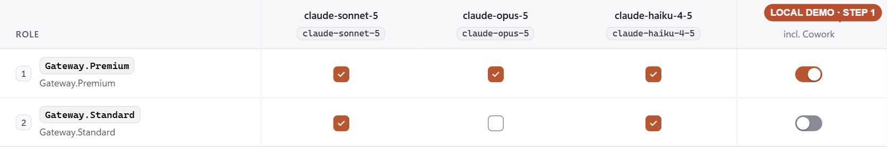
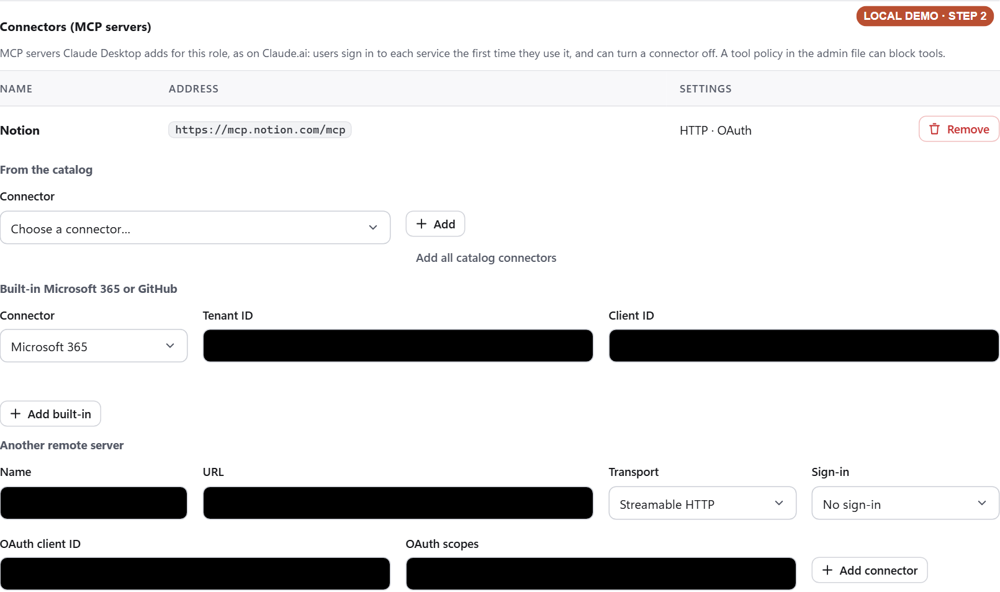
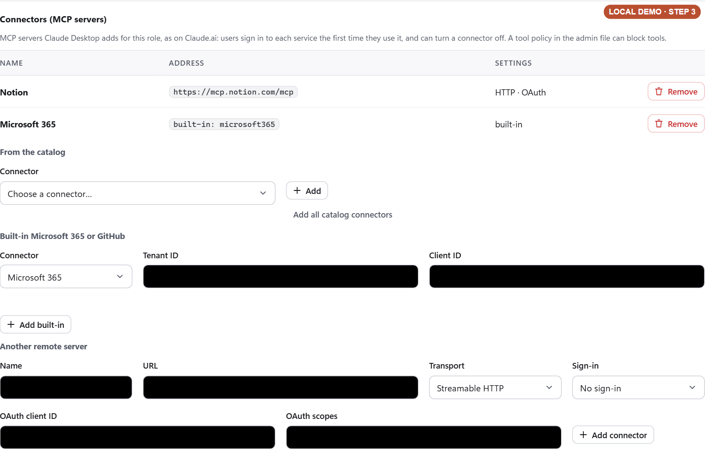
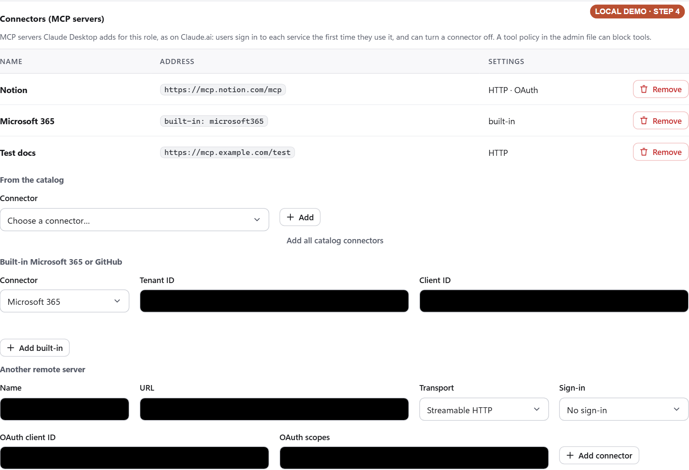
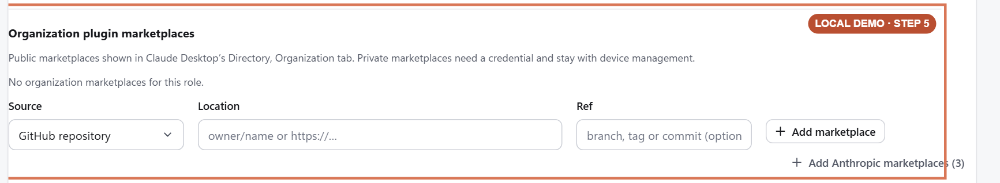
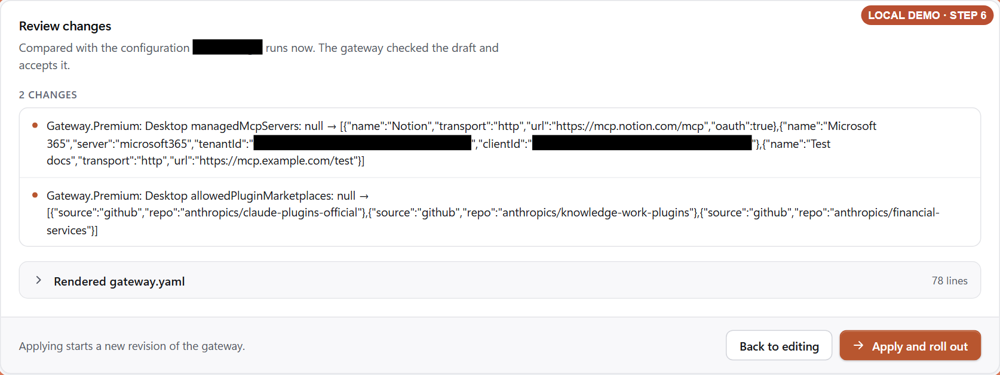
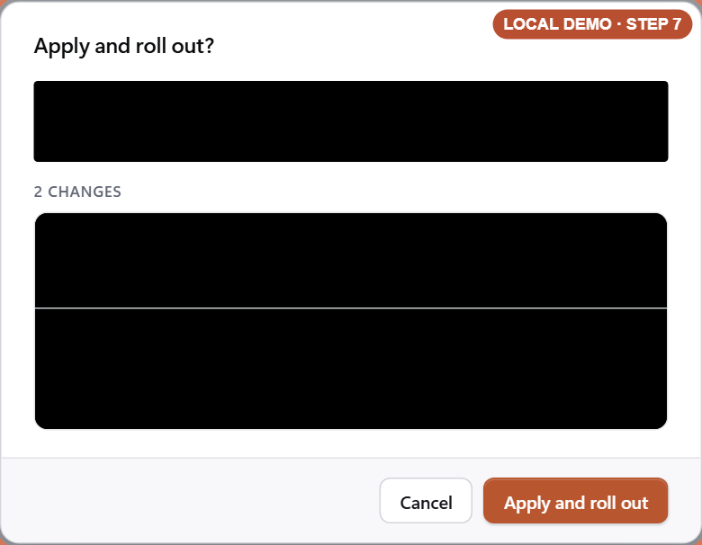
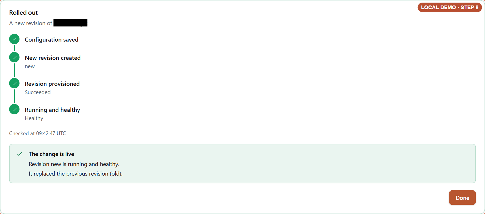

# Configure Claude Desktop connectors and plugins

Use your gateway admin console to show approved connectors and Anthropic plugin marketplaces to Claude Desktop users.

## What to expect

| Question | Answer |
|---|---|
| How long does it take? | Plan for about 15 minutes. App setup or approvals can take longer. |
| Does it cost money? | This adds no Azure resource. Existing gateway and vendor charges still apply. |
| What changes? | The selected gateway role gets a new configuration and gateway revision. |
| What changes on my computer? | Nothing on the administrator's computer. Users may need to restart Claude Desktop. |
| Do I need admin rights? | Yes. You need `AdminUi.Admin` and gateway configuration write access. |
| Do I need internet? | Yes. The browser must reach the console. Users need access to each connector vendor. |
| What does this not do? | It does not sign users in to vendors or prove that a tool can read data. |

This guide changes Desktop policy for one gateway role.
It starts a gateway revision when you apply the change ([admin console guide](how-to-use-admin-console.md)).
It does not change policy for terminal Claude Code ([ADR-0020](../adr/0020-desktop-connectors-and-plugin-policy-through-the-gateway.md)).
See the [gateway Desktop overlay](https://code.claude.com/docs/en/claude-apps-gateway-config#claude-desktop-overlay).

Screenshots in this guide come from a local in-memory demo. They do not show a customer gateway.

## Before you start

| # | You need | Version or detail | Check it | Get it |
|---|---|---|---|---|
| 1 | Existing gateway and admin console | The gateway must support Desktop policy settings. The documented minimum for managed connectors is Claude Code 2.1.232. | Ask your gateway operator which gateway build is deployed. | Your gateway operator |
| 2 | Admin console access | `AdminUi.Admin` and the required write permissions | Sign in and open **Access & models**. | Ask your Entra administrator or gateway operator. |
| 3 | Claude Desktop | 1.2581.0 or later for managed connectors; 1.37937.0 for user plugin controls | Check your organization's approved Desktop version. | Your software administrator |
| 4 | Target gateway role | Users must already hold this gateway role. | Check **Access & models** > **Role access**. | Ask your Entra administrator. |
| 5 | Microsoft 365 app details, if needed | Your organization's Entra tenant ID, app client ID, and delegated Graph scopes | Ask the owner of your Entra app registration. | Your Entra administrator |
| 6 | Vendor setup, if needed | The vendor's remote MCP URL and supported sign-in method | Check the vendor's MCP setup guide. | The connector vendor |

Microsoft 365 needs your organization's own Entra app registration. Use delegated scopes that match the work users need.
For example, `User.Read` and `Mail.Read` are delegated scopes for profile and mailbox reads.
Do not grant application-wide mailbox or file access for this setup.

GitHub needs a client ID from your GitHub OAuth app with device flow enabled, or from a GitHub App.
Salesforce needs your organization's public External Client App client ID and its required scopes.
Do not put client secrets in this gateway configuration.
See the [Desktop setup requirements](how-to-desktop-plugins-connectors.md#prerequisites).
See [Claude Desktop configuration](https://claude.com/docs/third-party/claude-desktop/configuration).

## Check your machine is ready

This guide starts at an existing gateway admin console. No local install or command is needed.
Open the console address supplied by your gateway operator.
Confirm that you can sign in and open **Access & models**.

If that page is read-only, ask the gateway operator to check your access before continuing.
The [console guide](how-to-use-admin-console.md) explains the required access.
See the [gateway Desktop overlay](https://code.claude.com/docs/en/claude-apps-gateway-config#claude-desktop-overlay).

## Steps

### Step 1 — Turn on Desktop for a role

**Do this**

1. Turn on **Claude Desktop** for the target role in **Access & models** > **Role access**.

**What you should see**

The switch is on for that role. Other role switches keep their current state.

This switch controls access by gateway role. Check that the intended users hold that role.
If a user has several gateway roles, the first matching policy applies.
See [role access and Desktop settings](how-to-admin-configure.md#enable-import-plugins-and-extensions).

### Step 2 — Add a catalog connector

**Do this**

1. Under **Connectors (MCP servers)** > **From the catalog**, choose one service and select **Add**.

**What you should see**

The connector appears in the list for this role. The list shows its name, address, and sign-in type.

Catalog entries are remote MCP services. Many use OAuth sign-in through the vendor.
Users sign in to each vendor the first time they use its connector.
They can turn a connector off in Desktop.
See the [connector catalog and sign-in details](how-to-desktop-plugins-connectors.md#add-connectors).

### Step 3 — Add a built-in connector

**Do this**

1. Add the built-in Microsoft 365 connector with your tenant ID and app client ID.

**What you should see**

The connector list shows **Microsoft 365** as a built-in entry. The IDs are not shown in the list.

Use **Built-in Microsoft 365 or GitHub** for these Desktop connectors.
Microsoft 365 uses your Entra app and its delegated scopes.
GitHub uses your GitHub app's client ID.
These are not catalog URLs.
See the [Microsoft 365 and GitHub setup](how-to-desktop-plugins-connectors.md#microsoft-365-and-github).

### Step 4 — Add another remote MCP server

**Do this**

1. Add a remote server in **Another remote server**.

**What you should see**

The new entry appears with its HTTPS address and transport.
The screenshot uses `example.com` test data, not a working vendor address.

Use the vendor's exact HTTPS address and transport.
Choose no sign-in, automatic OAuth registration, or OAuth with your own client ID.
Automatic registration works only when the vendor supports it.

For Salesforce, choose **OAuth with your client ID (no secret)**.
Enter your organization's public Salesforce client ID and the scopes `mcp_api refresh_token`.
The Salesforce hosted server does not offer automatic client registration.

The console does not accept connector headers, client secrets, local commands, or private marketplace credentials.
Use your device management policy for those settings ([ADR-0020](../adr/0020-desktop-connectors-and-plugin-policy-through-the-gateway.md)).

### Step 5 — Add Anthropic marketplaces

**Do this**

1. Select **Add Anthropic marketplaces** under **Organization plugin marketplaces**.

**What you should see**

The list includes the three Anthropic repositories.

The added repositories are `anthropics/claude-plugins-official`, `anthropics/knowledge-work-plugins`, and `anthropics/financial-services`.
This makes those organization marketplaces available; it does not install every plugin.
Only plugins included in each marketplace repository can appear.
Other Claude.ai Directory items are not guaranteed to work in Claude Desktop.

To let users add their own marketplaces, enable **Allow user-added plugin marketplaces** for this role.
That option is separate from adding organization marketplaces.
See [marketplace setup](how-to-desktop-plugins-connectors.md#make-plugins-available).

### Step 6 — Review the draft

**Do this**

1. Select **Review changes** at the bottom of the page.

**What you should see**

The console lists the proposed role changes. The gateway checks the draft before showing it.

Check the role and each connector or marketplace in the list.
The gateway does not change until you apply the reviewed draft ([admin console guide](how-to-use-admin-console.md)).

### Step 7 — Open the apply confirmation

**Do this**

1. Select **Apply and roll out** in the review card.

**What you should see**

A confirmation explains that the change starts a new gateway revision ([admin console guide](how-to-use-admin-console.md)).

### Step 8 — Confirm the rollout

**Do this**

1. Select **Apply and roll out** in the confirmation dialog.

**What you should see**

The console reports when the new revision is running and healthy.

Do not treat this message as proof of vendor sign-in or tool access.
After the rollout, users can open Claude Desktop **Directory** > **Organization** to find organization marketplaces.
Ask users to restart Desktop so it reads the new settings.
Desktop also checks for settings about every ten minutes.
See [Desktop pickup timing and verification](how-to-desktop-plugins-connectors.md#when-desktop-applies-a-change).
See [Claude Desktop configuration](https://claude.com/docs/third-party/claude-desktop/configuration).

## Check it worked

In the admin console, open **Access & models** > **Role access**.
Confirm the target role still has Claude Desktop enabled.
Confirm the selected connector and marketplace entries remain under that role.
Then check the rollout status for a healthy revision.

Ask one test user in that role to restart Claude Desktop.
The user can find organization marketplaces in **Directory** > **Organization**.
The user must still sign in to each vendor before using its connector.
See [what live verification establishes](how-to-desktop-plugins-connectors.md#what-live-verification-establishes).
See [Claude Desktop configuration](https://claude.com/docs/third-party/claude-desktop/configuration).

## Common problems

| What you see | Why it happens | What to do |
|---|---|---|
| No **Desktop capabilities** card | Claude Desktop is off for the role. | Turn it on under **Access & models** > **Role access**. |
| **Review changes** is disabled | A connector value is invalid or unsupported. | Use an HTTPS URL and remove secrets, headers, or local commands. |
| A connector is listed but sign-in fails | The vendor needs its own account, app registration, scope, or approval. | Follow that vendor's sign-in guide. Check client network access. |
| A marketplace is missing in Desktop | Desktop may still have its earlier settings. | Restart Claude Desktop. Then check **Directory** > **Organization** again. |
| A tool is listed but cannot read data | Configuration does not prove authentication or data access. | Test an approved read-only tool with the intended user and vendor. |
| A private marketplace cannot be added | The console does not accept marketplace credentials. | Deliver it through Intune or Group Policy. |

For more causes, see [Desktop connector troubleshooting](how-to-desktop-plugins-connectors.md#settings-that-stay-with-device-management).
See [Claude Desktop configuration](https://claude.com/docs/third-party/claude-desktop/configuration).

## Clean up

Remove a connector or marketplace from the target role in **Access & models** > **Desktop capabilities**.
Review the change and apply it through Steps 6–8.
Users may need to restart Desktop before the removed entry disappears.

Removing a gateway entry does not revoke a user's vendor sign-in or consent.
Ask the vendor administrator to revoke access when that is required.
Do not remove an Entra app registration that other services still use.
See [the policy limits in ADR-0020](../adr/0020-desktop-connectors-and-plugin-policy-through-the-gateway.md).
See [Claude Desktop configuration](https://claude.com/docs/third-party/claude-desktop/configuration).

## Limits

- These connector and marketplace settings apply to Claude Desktop roles.
- Terminal Claude Code plugin policy is not implemented by this gateway configuration.
- Vendor sign-in varies. A connector entry does not prove an authenticated tool call.
- The catalog is a maintained list. Vendor addresses and sign-in rules can change.
- A marketplace does not promise that every Claude.ai Directory plugin works here.
- Settings with secrets, headers, local commands, or private marketplace credentials stay in device management.

These limits follow the accepted policy in [ADR-0020](../adr/0020-desktop-connectors-and-plugin-policy-through-the-gateway.md).
See the [gateway Desktop overlay](https://code.claude.com/docs/en/claude-apps-gateway-config#claude-desktop-overlay).

## Where to get help

- Ask your gateway operator about console access, gateway versions, or a failed rollout.
- Ask your Entra administrator about the Microsoft 365 app and delegated scopes.
- Ask the connector vendor about its endpoint, scopes, account access, and sign-in.
- [Use the admin console](how-to-use-admin-console.md)
- [Desktop connectors and plugins](how-to-desktop-plugins-connectors.md)
- [Desktop policy decision](../adr/0020-desktop-connectors-and-plugin-policy-through-the-gateway.md)
- [Connector and marketplace catalog](../../admin-ui/web/desktop-catalog.js)
- [Claude Desktop configuration](https://claude.com/docs/third-party/claude-desktop/configuration)
- [Microsoft 365 local connector setup](https://claude.com/docs/third-party/claude-desktop/connectors-m365#local-connector)
- [Salesforce public client setup](https://developer.salesforce.com/docs/platform/hosted-mcp-servers/guide/create-external-client-app.html)
