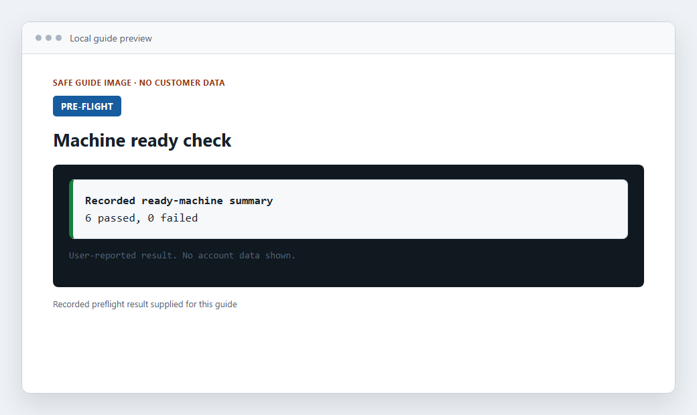
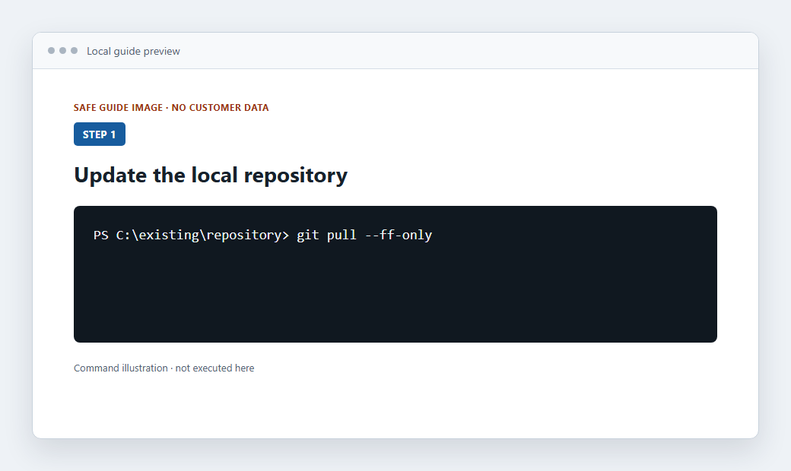
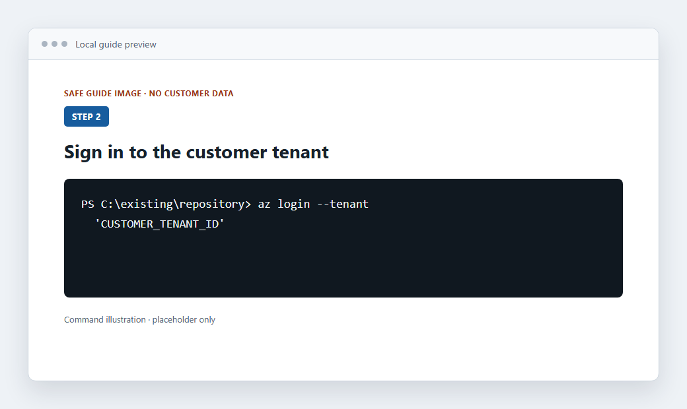
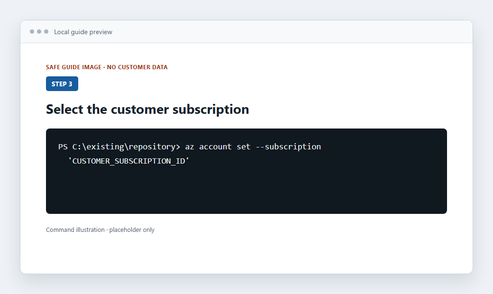
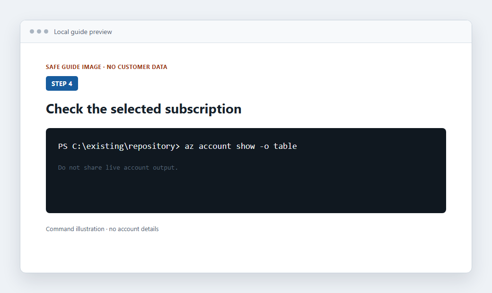
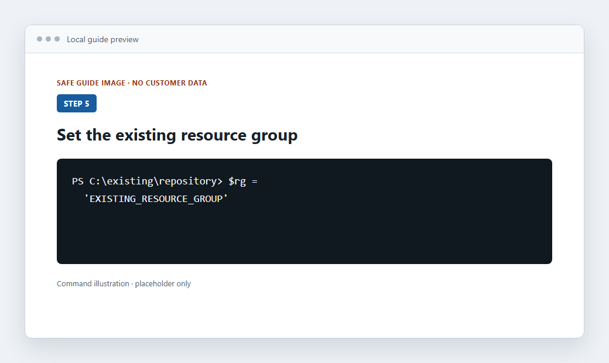
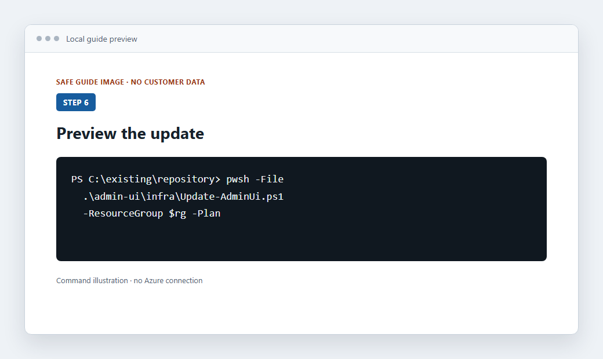
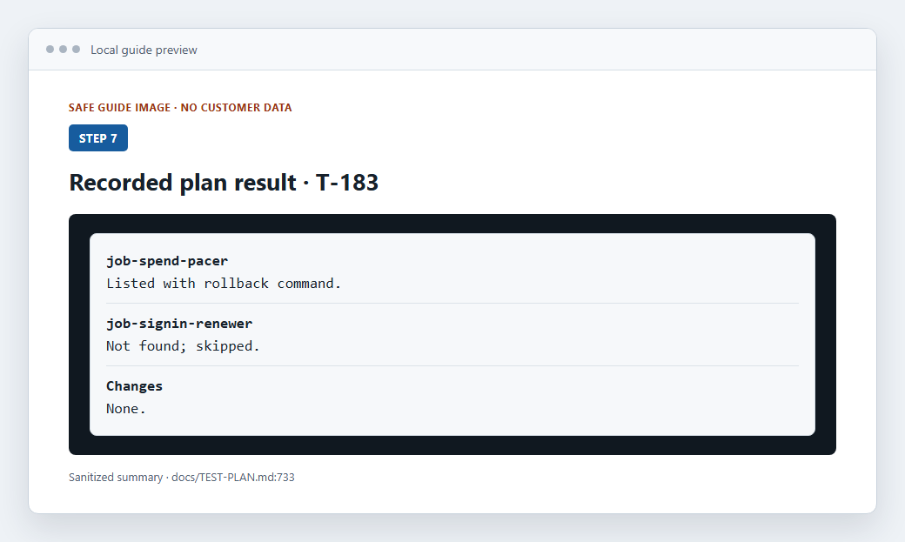
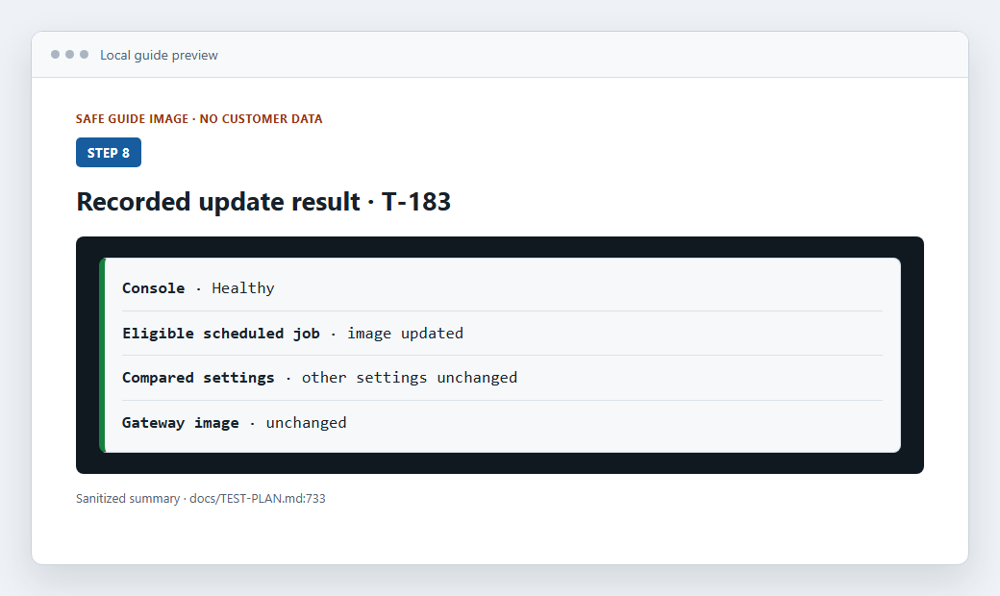

# Update an existing admin console

Update the console image in an existing installation without reinstalling its gateway or database.

## What to expect

| Question | Answer |
|---|---|
| How long does it take? | The Contoso update took about 3 minutes. Your Azure image build or health checks may take longer (docs/TEST-PLAN.md:733). |
| Does it cost money? | Azure charges continue for resources that are already running. Check your Azure cost view for your amount. |
| What changes? | The console image changes. Eligible admin-ui scheduled job images may change to match. |
| What changes on this computer? | `git pull` updates the local repository. The updater keeps the local admin file and `.state` records. |
| Do I need admin rights? | Your Azure account needs permission to build in the existing registry, update the console, and read its authentication settings. |
| Do I need internet access? | Yes. Git and Azure CLI must reach their hosted services. |
| What does this not do? | It does not rebuild the gateway database, update the gateway, register an app, grant roles, or call Microsoft Graph. |

The script checks console settings and health. It prints rollback commands before image changes.
The spend-pacer job may create the documented spend-history table when it runs; this is not a database rebuild.

The documented workflow is in [how-to-update-admin-console.md](how-to-update-admin-console.md).
The updater's options are in [reference-scripts.md:364-377](reference-scripts.md).
Recorded test results are in [docs/TEST-PLAN.md:720-734](../TEST-PLAN.md).

## Before you start

Use the existing installer computer. Open PowerShell 7 from the existing repository folder.
Use the customer's tenant, subscription, and resource group.
Ask the person who performed the installation for any value you do not know.
These requirements match the existing update guide (docs/learn/how-to-update-admin-console.md:18-21).

| # | You need | Version | Check it with | Where to get it |
|---|---|---|---|---|
| 1 | PowerShell | 7 or newer | `pwsh --version` | [Install PowerShell](https://learn.microsoft.com/powershell/scripting/install/installing-powershell-on-windows) |
| 2 | Git | Any installed version | `git --version` | [Install Git for Windows](https://git-scm.com/download/win) |
| 3 | Azure CLI | Installed | `az version` | [Install Azure CLI](https://learn.microsoft.com/cli/azure/install-azure-cli-windows) |
| 4 | Container Apps extension | Installed | `az extension show --name containerapp --query name -o tsv` | [Azure CLI extensions](https://learn.microsoft.com/cli/azure/azure-cli-extensions-overview) |
| 5 | Existing repository | Current customer checkout | The preflight check below | Ask your installer or repository owner |
| 6 | Azure access | Customer tenant and subscription | The preflight check below | Ask your Azure administrator |

Do not continue if the repository, tenant, subscription, or resource group is unclear.
The update does not need a new app registration or a new role grant.

## Check your machine is ready

Run this command from the existing repository folder:

```powershell
pwsh -NoProfile -File scripts\preflight.ps1 -Manifest scripts\customer-update-preflight.json
```

**What you should see**

The recorded ready-machine check reported `6 passed, 0 failed`. Your run must show no failed checks.



If a check fails, follow the fix printed for that check. Run the preflight command again.
Do not continue while any check fails.

The screenshot is a safe reproduction of the recorded summary. It contains no customer account details.
The six checks are defined in scripts/customer-update-preflight.json:1.

## Steps

The steps follow the tested update process (docs/learn/how-to-update-admin-console.md:26-66; docs/learn/reference-scripts.md:364-377).

### Step 1 — Update the local repository

**Do this**

Run this command from the repository folder:

```powershell
git pull --ff-only
```

**What you should see**

Git finishes without an error. The repository is ready for the update steps.



### Step 2 — Sign in to the customer tenant

**Do this**

Replace `CUSTOMER_TENANT_ID` with the tenant ID from your Azure administrator. Run:

```powershell
az login --tenant 'CUSTOMER_TENANT_ID'
```

**What you should see**

Azure CLI completes sign-in to the customer tenant. Keep its output private because it may show account details.



Do not share sign-in output. It can contain account details.

### Step 3 — Select the customer subscription

**Do this**

Replace `CUSTOMER_SUBSCRIPTION_ID` with the subscription ID for the existing installation. Run:

```powershell
az account set --subscription 'CUSTOMER_SUBSCRIPTION_ID'
```

**What you should see**

The command returns without an error. Check the selected subscription in Step 4.



### Step 4 — Check the selected subscription

**Do this**

Run this command:

```powershell
az account show -o table
```

**What you should see**

The table names the subscription for the existing console. Do not share the table or a screenshot of it.



If the subscription is wrong, stop. Repeat Step 3 with the correct subscription ID.

### Step 5 — Set the existing resource group

**Do this**

Replace `EXISTING_RESOURCE_GROUP` with the resource group that contains the existing console. Run:

```powershell
$rg = 'EXISTING_RESOURCE_GROUP'
```

**What you should see**

PowerShell returns to the prompt without an error. `$rg` now names the existing resource group.



### Step 6 — Preview the update

**Do this**

Run the plan command:

```powershell
pwsh -File .\admin-ui\infra\Update-AdminUi.ps1 -ResourceGroup $rg -Plan
```

**What you should see**

The plan shows the target console, current images, rollback commands, plus eligible scheduled jobs.
It builds nothing. It changes no Azure resource.



### Step 7 — Review the plan

**Do this**

Check the resource group, console, target image, plus rollback commands.

**What you should see**

The recorded plan listed `job-spend-pacer` with a rollback command.
It skipped the missing `job-signin-renewer` job. No Azure resource changed.



This result is from the recorded test, not a promise that your jobs match it.
A missing job or a job using another registry can be skipped.
Stop if the target or any rollback image is unexpected.

### Step 8 — Update the console image

**Do this**

Run the same command without `-Plan`:

```powershell
pwsh -File .\admin-ui\infra\Update-AdminUi.ps1 -ResourceGroup $rg
```

**What you should see**

The console reaches Healthy status. Authentication, ingress, identity, secrets, environment: all unchanged.
Eligible scheduled jobs move to the console image. The script checks their settings after each update.



The recorded run kept all other compared settings unchanged.
The gateway image and gateway database were not rebuilt.
On an error, keep the printed rollback commands. Ask your Azure administrator to review them.

## Check it worked

The update is complete when the command exits successfully after its health and settings checks.
The recorded workflow passed twice on an existing installation ([docs/TEST-PLAN.md:720-734](../TEST-PLAN.md)).

Do not treat a failed health check or settings comparison as success.
Use the printed rollback commands with your Azure administrator if a rollback is needed.
The existing guide explains [console image rollback](how-to-update-admin-console.md#roll-back-the-console-image).

## Common problems

The recorded tests cover image failures, skipped jobs, and preservation checks (docs/TEST-PLAN.md:733; docs/learn/how-to-update-admin-console.md:51-66).

| What you see | Why it happens | What to do |
|---|---|---|
| A preflight check fails | A required tool, extension, sign-in, or file is missing | Follow that check's printed fix, then rerun preflight |
| `git pull --ff-only` stops | The current branch has local changes or has diverged from its remote | Ask the repository owner to review the local changes before updating the branch |
| The plan names another console | The wrong subscription or resource group is selected | Stop; select the correct subscription and resource group |
| The plan skips a scheduled job | The job is missing or does not use an eligible admin-ui image | Leave it unchanged; review it with your administrator |
| The update reports a changed setting or unhealthy revision | The safety check did not pass | Do not call it successful; use the printed rollback commands with your administrator |

## Clean up

There is nothing to uninstall. The update changes the console image and eligible scheduled job images.
It does not stop existing Azure resources.
Azure charges continue for resources that are already running.
The local admin file and `.state` records stay in place.
The update replaces the existing image instead of creating a new installation (docs/learn/how-to-update-admin-console.md:11-14).

## Where to get help

The update guide has the rollback steps (docs/learn/how-to-update-admin-console.md:146-154).

- Ask your Azure administrator to confirm the tenant, subscription, resource group, and Azure permissions.
- Ask the repository owner for help with local Git changes.
- See [Update an existing admin console](how-to-update-admin-console.md) for rollback details.

## Screenshot notes

Command screenshots use a local synthetic page. They show commands only, not a live Azure session.
The plan and update images use sanitized summaries from T-183 in `docs/TEST-PLAN.md:733`.
The preflight image uses the recorded result supplied for this guide.
No live deployment or local demo configuration was changed to make these images.
The plan and update evidence is recorded in docs/TEST-PLAN.md:733.
