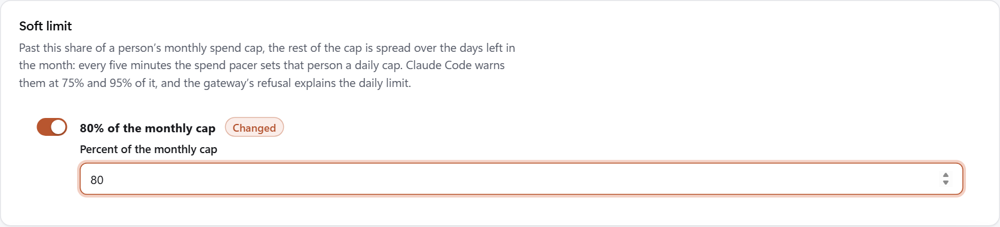

# Configure models, roles and developer access

The admin scripts change three things on the Azure test deployment: which models the gateway serves and which roles
may use them, which users hold a gateway role, and what developer machines receive. Each script checks its input and
writes nothing when a check fails (docs/adr/0004-operator-and-developer-tooling.md:52-54).

## Prerequisites

| Task | Needs |
|---|---|
| Every task | Node.js 22 or later, and this repository |
| Deploy a configuration change | The state file `infra/azure-test/.state/<resource group>.json` that `infra/azure-test/deploy.mjs` wrote; the Azure CLI signed in with `az login`, `az account set --subscription <subscription>` for the deployment's subscription, and Owner on it, as for the deployment itself ([install prerequisites](how-to-install-stage-by-stage.md#prerequisites)) |
| Grant or remove a role | The state file, from which `set-developer.mjs` reads the gateway's service principal (scripts/admin/set-developer.mjs:107); the [Azure CLI](https://learn.microsoft.com/en-us/cli/azure/install-azure-cli) signed in to the deployment's tenant with `az login --tenant <tenantId>` (the `tenantId` in the state file), because `set-developer.mjs` calls Microsoft Graph with that sign-in (infra/azure-test/lib/azure-rest.mjs:17); and an account that can assign users to the gateway's enterprise application: Cloud Application Administrator, Application Administrator, User Administrator, or an owner of its service principal ([assign users and groups](https://learn.microsoft.com/en-us/entra/identity/enterprise-apps/assign-user-or-group-access-portal)). The account that ran `deploy.mjs` is an owner |
| Change models and per-role model access, or generate client payloads | Nothing more: `new-gateway-config.mjs` reads the admin file and the Entra application manifest in the repository, `infra/azure-test/entra-app.json` (scripts/admin/new-gateway-config.mjs:342-354), and `new-client-policy.mjs` reads only its options |

The commands use the file names and resource group of [the first-install tutorial](tutorial-first-install.md). After the
admin console has saved the configuration, the `app` stage deploys the console's configuration, not the file, so models
and roles are then changed on the console's **Access & models** page
(docs/adr/0010-admin-ui-writes-gateway-config-roles-and-chargeback.md:117), and `set-developer.mjs`, which checks roles
against the file, grants only roles the file also lists. The deployment's tester range, which `--tester-cidr` needs, is
in the state file:

```powershell
$rg = 'rg-claude-gw-eval'   # the deployment's resource group, as in the first-install tutorial
(Get-Content "infra\azure-test\.state\$rg.json" -Raw | ConvertFrom-Json).testerCidr
```

## Change models and per-role model access

The gateway configuration `config/gateway.azure-test.yaml` is rendered from the admin file
`config/gateway-admin.azure-test.json`, and a test fails when the two differ (tests/admin-config.test.mjs:42). The
rendering of the fixed sections, the ADR-0003 topology, is part of the script.

| Key | Meaning |
|---|---|
| `roles` | The app roles the gateway admits, from `infra/azure-test/entra-app.json`; they become `oidc.allowed_groups` |
| `models` | Each model's `id` for clients, optional `label`, and the Foundry `deployment` that serves it |
| `policies` | Optional: one entry per admitted role, `{ "role": ..., "models": [...] }`, in the order the gateway checks them |
| `policies[].desktop` | Optional boolean. Claude Desktop's own sign-in endpoint, `/user/bootstrap`, answers 404 unless the matching policy carries a `desktop` key ([Claude Desktop overlay](https://code.claude.com/docs/en/claude-apps-gateway-config#claude-desktop-overlay)); a role without `desktop: true` gets the terminal and VS Code/JetBrains extensions (the `cli` key covers all three) but not Desktop. Absent, a policy falls back to `deployment.desktop`'s own default (scripts/admin/desktop-settings.mjs:26) |

1. Edit the admin file. This example gives `Gateway.Premium` both models and `Gateway.Standard` one:

   ```json
   {
     "roles": ["Gateway.Standard", "Gateway.Premium"],
     "models": [
       { "id": "claude-opus-5", "label": "Claude Opus 5", "deployment": "claude-opus-5" },
       { "id": "claude-sonnet-5", "label": "Claude Sonnet 5", "deployment": "claude-sonnet-5" }
     ],
     "policies": [
       { "role": "Gateway.Premium", "models": ["claude-opus-5", "claude-sonnet-5"] },
       { "role": "Gateway.Standard", "models": ["claude-sonnet-5"] }
     ]
   }
   ```

1. Render the configuration:

   ```powershell
   node scripts/admin/new-gateway-config.mjs --topology test --admin config/gateway-admin.azure-eval.json --out config/gateway.azure-eval.yaml
   ```

   ```output
   wrote config/gateway.azure-eval.yaml: 2 models, 2 roles, 2 policies.
   Deploy it with: node infra/azure-test/deploy.mjs --tester-cidr <range> --step app
   ```

   The generated `Deploy it with` line is a generic hint; this deployment also requires the resource group, config and
   Foundry values. The complete command is below.

1. Deploy it with the tester range from the state file. Until the admin console's first save, the app step replaces
   the configuration secret with the file and waits for the new revision; after it, the step keeps the console's
   configuration:

   ```powershell
   $range = (Get-Content "infra\azure-test\.state\$rg.json" -Raw | ConvertFrom-Json).testerCidr
   node infra/azure-test/deploy.mjs --tester-cidr $range --step app --resource-group $rg --config config/gateway.azure-eval.yaml --foundry-resource-group <Foundry resource group> --foundry-account <Foundry account> --client-secret-days 30
   ```

The gateway enforces each policy's `availableModels` at `/v1/messages`, so a request for another model gets `400`
([managed](https://code.claude.com/docs/en/claude-apps-gateway-config#managed)). A user who matches no policy may use
every model in the catalog, so the script requires a policy for every admitted role and renders no `match: {}`
policy. A policy's other `cli` keys reach only clients that sign in through `/login`
([Claude apps gateway](https://code.claude.com/docs/en/claude-apps-gateway)).

The script stops with exit code 1 on a role the Entra manifest does not define, a model without a deployment, a
policy model or role outside the lists, an admitted role without a policy, a duplicate, an unknown key, an entry that
is not an object, or a label with a line break or a `$`. The gateway replaces `${VAR}` in a value with an
environment variable, also inside a longer string, and a whole `${file:/path}` value with the file's content
([secret expansion](https://code.claude.com/docs/en/claude-apps-gateway-config#secret-expansion)), and it serves each
label to every signed-in user. A `$` in a label could therefore publish a gateway secret, so the renderer also refuses
a `$` in every value it takes from the admin file (scripts/admin/new-gateway-config.mjs:18-22). `--check` reports a
configuration that differs from the admin file, or an admin file with a problem, without writing.

## Claude Desktop: Chat, Cowork and Code

A policy with `"desktop": true` opts its role in to Claude Desktop. Its optional `desktopSettings` sets Desktop's three
switches for that role: `chatTabEnabled`, `coworkTabEnabled` and `isClaudeCodeForDesktopEnabled`, each `true` or `false`
(scripts/admin/desktop-settings.mjs:1-5). The gateway serves them from `/user/bootstrap`, and Desktop applies them over
its local settings as read-only values
([Desktop configuration](https://claude.com/docs/third-party/claude-desktop/configuration#chattabenabled)). A switch
left out keeps Desktop's default; the settings are kept but not served while the policy's `desktop` is `false`.

```json
{ "role": "Gateway.Premium", "models": ["claude-sonnet-5", "claude-opus-5"], "desktop": true,
  "desktopSettings": { "chatTabEnabled": true, "coworkTabEnabled": false } }
```

Desktop reads the gateway's values when it starts, so a change reaches a developer after Desktop restarts. On
2026-10-26, with Claude Desktop 2.42304.2.0 against the public Contoso gateway, Chat on with Cowork off showed Home and
Code with a Chats list, and Cowork on with Chat and Code off showed only a Tasks list (docs/TEST-PLAN.md, T-123).

## Pace the last part of a monthly cap with a soft limit

A soft limit spreads the last part of a person's monthly spend cap over the rest of the month. Once a person's spend
passes the set share of their monthly cap, for example 80%, the gateway gives them a daily cap of the remaining budget
divided by the days left in the month, today included, in whole cents
(scripts/admin/spend-pacing.mjs:110-114). For a $100 monthly cap, with $85 spent of which $3 today, on 27 October
(five days left): (100 − 82) ÷ 5 = $3.60 a day. The amount stays the same all day and is worked out again each day.

The gateway still enforces every cap on each request, as before. The soft limit changes how fast the end of a budget
can be spent; it does not make the spend count more exact, which the gateway already checks before every request
([how enforcement works](https://code.claude.com/docs/en/claude-apps-gateway-spend-limits#how-enforcement-works);
docs/adr/0014-soft-limit-and-daily-spend-pacing.md:24-27).

| Part | What it does | Source |
|---|---|---|
| `job-spend-pacer` | A Container Apps job that runs every five minutes, from the admin console's image and identity. It reads each person's spend and caps from the gateway's admin API and sets, changes or deletes their daily cap. | admin-ui/infra/main.bicep:201-215 |
| `spend-pacer` key | The job writes with its own key, so the console's **Audit** page lists its changes as `spend-pacer (admin key)`. It deletes only the daily caps it set. | admin-ui/server/pacer-job.mjs:45 |
| `admin-pacer-key` | The secret that holds the job's key on the gateway app, as `GATEWAY_ADMIN_PACER_KEY`. The installer's `app` stage creates it and keeps its value on later runs. | infra/azure-test/gateway-test.json:239, infra/azure-test/lib/credentials.mjs:50 |

Rules:

- A role or organization daily cap that is lower than the pace applies instead, and no daily cap is set for the person
  (scripts/admin/spend-pacing.mjs:116).
- A per-user daily cap that an administrator set on **Budgets** is never changed or deleted; that person is not paced.
- Below the soft limit, for example in a new month, or with the soft limit off, the job deletes the daily caps it set.

### Turn the soft limit on

Prerequisites: the admin file has `"deployment": { "adminApi": true }`; the gateway has `GATEWAY_ADMIN_PACER_KEY`,
which the installer's `app` stage adds; and `job-spend-pacer` exists, which `Deploy-AdminUi.ps1` deploys with the
console. On a gateway without the variable, the console refuses the change and says to run the `app` stage
(admin-ui/server/gateway-config.mjs:178).

1. In the admin console, open **Access & models**.
1. In the **Soft limit** card, turn the switch on. The share starts at 80%; type another whole number from 1 to 99 to
   change it.

   

1. Select **Review changes**. The list shows `Soft limit: off → 80% of the monthly cap`.
1. Select **Apply and roll out**, and wait until the new revision is running and healthy.

Before the console's first save, the same setting is the admin file key `"spendPacing": { "softLimitPercent": 80 }`,
deployed with the `app` stage. Turning the switch off removes the key, and the job's next run deletes its daily caps.

### What a developer sees

Claude Code warns a developer at 75% and again at 95% of their most-consumed cap, which is now the daily cap, and shows
it in `/usage` ([usage warnings](https://code.claude.com/docs/en/claude-apps-gateway-spend-limits#usage-warnings-in-claude-code)).
Over the daily cap, the gateway answers `429` until 00:00 UTC, and Claude Code shows the message as it is. On the
Contoso test gateway on 2026-10-27, with a 50% soft limit:

```output
API Error: Request rejected (429) · spend limit reached (daily; resets 2026-10-28 00:00 UTC) — If this is a daily limit: you have passed 50% of your monthly budget, so the rest is spread over the days left in the month, and the daily limit resets at 00:00 UTC. To raise the monthly budget, ask your gateway administrator.
```

### Limits

- A person can pass the soft limit and keep spending for up to five minutes before the job sets their daily cap.
- Requests that are already running when a cap is reached still finish and are counted, so spend can pass a cap by
  their cost. In the Contoso test, four parallel requests admitted at 6.5 cents ended at 8.1 cents against an 8-cent
  daily cap (docs/TEST-PLAN.md, T-139).
- The job runs whether or not the soft limit is on, at 0.25 vCPU and 0.5 GiB for a few seconds every five minutes:
  about 16,000 vCPU-seconds a month, about $0.50 at list price or nothing within the Container Apps monthly free grant
  ([Container Apps pricing](https://azure.microsoft.com/pricing/details/container-apps/)).

### Check that it works

- **Audit** lists each daily cap the job sets or changes, with the actor `spend-pacer (admin key)`.
- The job's runs and their result:

  ```powershell
  az containerapp job execution list -g $rg -n job-spend-pacer --query "[0:5].{name:name,status:properties.status,start:properties.startTime}" -o table
  ```

- Each run writes one line to the log, with counts and no names or addresses, for example
  `{"evt":"spend_pacer.run","percent":80,"paced":1,"set":1,"removed":0,"notPaced":0,"errors":0}`
  (admin-ui/server/pacer-job.mjs:85).

## Grant developer access

The gateway admits a user whose token carries one of its app roles (config/gateway.azure-test.yaml:22-23).
`set-developer.mjs` adds and removes app role assignments on the gateway's service principal through Microsoft Graph
([appRoleAssignedTo](https://learn.microsoft.com/en-us/graph/api/serviceprincipal-post-approleassignedto)). It grants
only a role the admin file admits, because the gateway would refuse its holder's sign-in. The admin file is the one
`new-gateway-config.mjs` renders from, `config/gateway-admin.azure-test.json` unless `--admin` names another; the script
reads it and checks it with the renderer's rules before any Graph request (scripts/admin/set-developer.mjs:41-52).

1. Grant a role. A second run reports that the user already holds it:

   ```powershell
   node scripts/admin/set-developer.mjs --upn dev@contoso.com --role Gateway.Standard --admin config/gateway-admin.azure-eval.json --resource-group $rg
   ```

   ```output
   Gateway.Standard granted to Dev One (dev@contoso.com)
   ```

1. List the users who hold each role:

   ```powershell
   node scripts/admin/set-developer.mjs --list --resource-group $rg
   ```

1. Remove a role. The user's other gateway role, and assignments of other apps, stay:

   ```powershell
   node scripts/admin/set-developer.mjs --upn dev@contoso.com --role Gateway.Standard --remove --admin config/gateway-admin.azure-eval.json --resource-group $rg
   ```

A guest's user principal name contains `#EXT#`; the script accepts it as Graph lists it. A change reaches the gateway
at the user's next sign-in or session refresh, within the session lifetime of one hour
([managed](https://code.claude.com/docs/en/claude-apps-gateway-config#managed)).

## Generate client payloads

`new-client-policy.mjs` writes two alternative sets of client files; a machine takes one of them, because under
`forceLoginMethod` Claude Code blocks an `apiKeyHelper` credential at startup
([authentication](https://code.claude.com/docs/en/authentication)).

1. Generate the files:

   ```powershell
   node scripts/admin/new-client-policy.mjs --gateway-url https://claude-gateway.corp.contoso.com --fast-model claude-sonnet-5 --model claude-sonnet-5 --out .\client-policy
   ```

1. Deliver one folder to each machine:

   | Folder | Content | Delivery |
   |---|---|---|
   | `login\` | `managed-settings.json`, `ClaudeCode-HKLM.reg`, `ClaudeCode.mobileconfig` | `managed-settings.json` in `C:\Program Files\ClaudeCode\`, `/Library/Application Support/ClaudeCode/` or `/etc/claude-code/` ([managed settings](https://code.claude.com/docs/en/managed-settings)); the `.reg` file through Group Policy or an installer; the `.mobileconfig` through MDM |
   | `developer\` | Every script of `scripts\developer`, and `START-HERE.txt`: the prerequisites (Windows PowerShell 5.1, Claude Code 2.1.272 or later, a network the gateway admits, a gateway role), the install, sign-in and sign-out commands to run from the folder, and the common messages with their fixes (scripts/admin/new-client-policy.mjs:102-106) | To the developer, for the [quickstart](quickstart-developer.md) |

The `login` payloads set `forceLoginMethod` to `gateway`, `forceLoginGatewayUrl` to the gateway, and
`parentSettingsBehavior` to `merge` ([set the gateway URL](https://code.claude.com/docs/en/claude-apps-gateway#set-the-gateway-url)).
`/login` accepts the gateway only when its name resolves to private addresses, so the script refuses a public IPv4
literal, an IPv6 literal, a URL that is not `https`, and a URL with a path, query or credentials. The configuration
profile's identifiers come from `--policy-id` (default `default`), so a new gateway URL with the same policy ID
updates the profile an MDM already holds. The payloads were checked by tests, not imported on a device.

## Related content

- [Quickstart: connect Claude Code on Windows](quickstart-developer.md)
- [Run the inference tests](how-to-test-inference.md)
- [Script reference](reference-scripts.md)