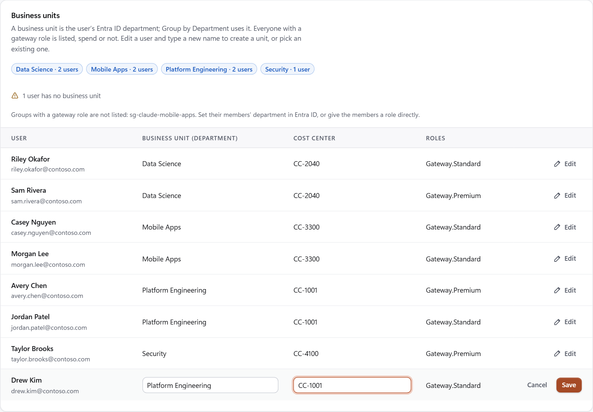
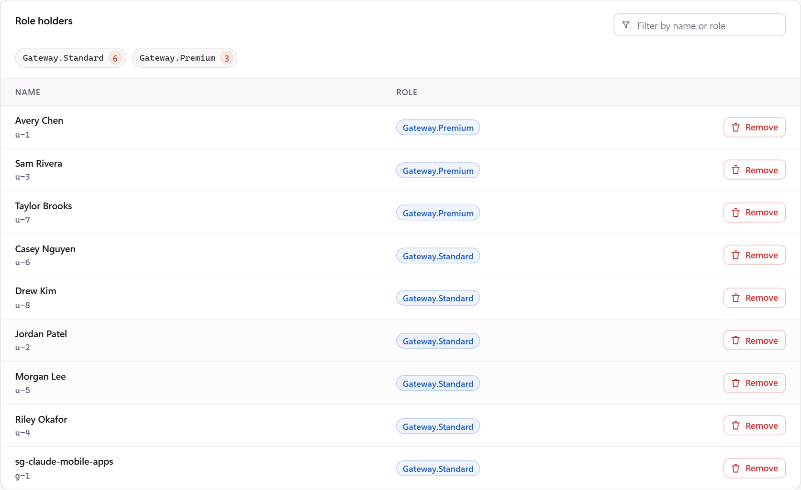
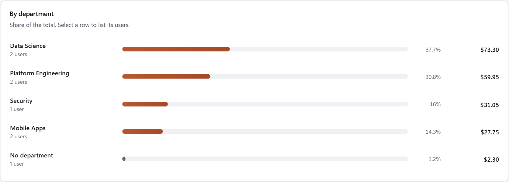
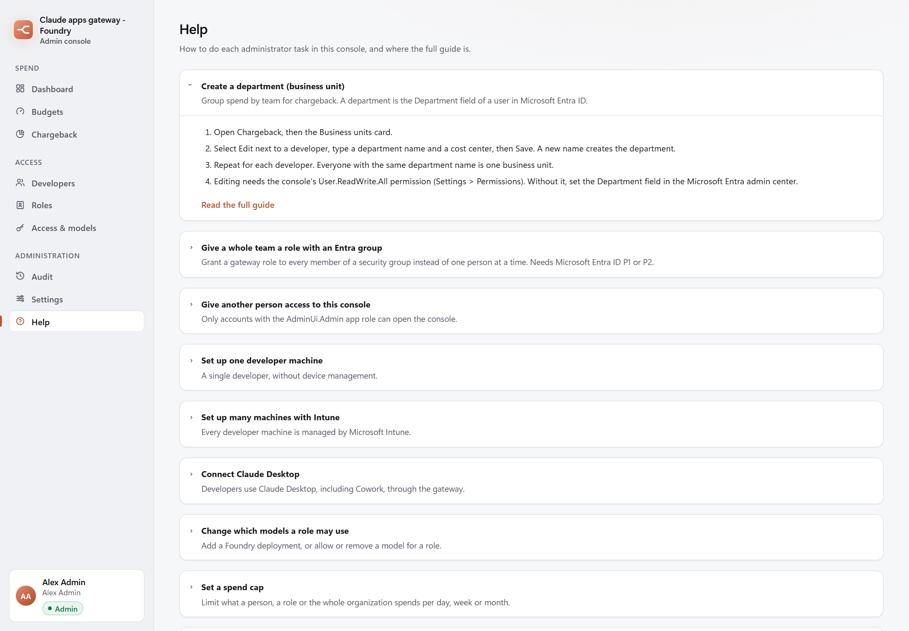

# Group developers into departments and teams

The admin console reports gateway spend per department on its **Chargeback** page. A department, called a
*business unit* in the console, is not a separate object: it is the **Department** attribute of each user in
Microsoft Entra ID, and the cost center is the user's **Cost center** (`employeeOrgData.costCenter`)
([user resource](https://learn.microsoft.com/en-us/graph/api/resources/user)). Everyone with the same department
name is one business unit (admin-ui/server/chargeback.mjs:129-131). A team can also be given a gateway role in one step
through an Entra security group.

The screenshots on this page come from the console running on made-up data: Contoso, its people and its
departments are examples.

| Task | Where | Needs |
|---|---|---|
| Create a department for a few people | Admin console, **Chargeback** > **Business units** | The console's Microsoft Graph permission `User.ReadWrite.All` |
| Create a department without that permission | Microsoft Entra admin center | The User Administrator role ([least privileged roles](https://learn.microsoft.com/en-us/entra/identity/role-based-access-control/delegate-by-task)) |
| Set departments for many people | Microsoft Graph PowerShell and a CSV file | The User Administrator role |
| Give a whole team a role | Microsoft Entra admin center, the gateway's enterprise application | Microsoft Entra ID P1 or P2; Application Administrator or Cloud Application Administrator |

## Create a department in the admin console

1. Open the console and select **Chargeback**. The **Business units** card lists every person who holds a gateway
   role, with or without spend (admin-ui/server/chargeback.mjs:111-135).
1. Select **Edit** on a person's row, type the department name and the cost center, and select **Save**. A name
   that no one has yet creates a new business unit; the field also offers the names that exist.
1. Repeat for each person.



**Save** writes the two attributes to the person's Entra ID account. It needs the console's Graph permission
`User.ReadWrite.All`, which `Deploy-AdminUi.ps1 -GrantUserWrite` grants
([script reference](reference-scripts.md)); without it the console answers
`User tagging requires the User.ReadWrite.All Microsoft Graph application permission.`, and **Settings** >
**Permissions** shows the permission as missing. Entra ID can take a short time to return the new value, so the
card can show the old name for a minute after **Save**.

## Set a department in the Microsoft Entra admin center

1. Sign in to the [Microsoft Entra admin center](https://entra.microsoft.com) as a User Administrator.
1. **Entra ID** > **Users** > **All users** > the person > **Properties** > **Edit properties**
   ([add or update a user's profile](https://learn.microsoft.com/en-us/entra/fundamentals/how-to-manage-user-profile-info)).
1. On **Job information**, set **Department** and, where the page shows it, **Cost center**. Select **Save**.

The console reads the same attributes, so the person appears under that department on the next **Chargeback**
report.

## Set departments for many users from a CSV file

Microsoft Graph PowerShell sets the attributes for a list of people. The module is installed once, then a User
Administrator signs in with the `User.ReadWrite.All` scope
([install](https://learn.microsoft.com/en-us/powershell/microsoftgraph/installation),
[Update-MgUser](https://learn.microsoft.com/en-us/powershell/module/microsoft.graph.users/update-mguser)).

`departments.csv`, one row per person:

```output
UserPrincipalName,Department,CostCenter
avery.chen@contoso.com,Platform Engineering,CC-1001
sam.rivera@contoso.com,Data Science,CC-2040
morgan.lee@contoso.com,Mobile Apps,CC-3300
```

```powershell
Install-Module Microsoft.Graph.Users -Scope CurrentUser
Connect-MgGraph -Scopes 'User.ReadWrite.All'
foreach ($row in Import-Csv .\departments.csv) {
    try {
        Update-MgUser -UserId $row.UserPrincipalName -Department $row.Department -EmployeeOrgData @{ CostCenter = $row.CostCenter } -ErrorAction Stop
        "updated $($row.UserPrincipalName): $($row.Department), $($row.CostCenter)"
    } catch {
        "failed  $($row.UserPrincipalName): $($_.Exception.Message)"
    }
}
```

The loop prints `updated` or `failed` for each row; a failed row, such as a name that is not in the directory, does
not stop the others. To read the values back:

```powershell
Get-MgUser -UserId avery.chen@contoso.com -Property Department,EmployeeOrgData | Select-Object Department, @{ n = 'CostCenter'; e = { $_.EmployeeOrgData.CostCenter } }
```

## Give a whole team a role with an Entra group

Instead of granting a role to one person at a time on the console's **Developers** page, an administrator can
assign the role to a security group. Every member of the group then holds the role
([assign users and groups](https://learn.microsoft.com/en-us/entra/identity/enterprise-apps/assign-user-or-group-access-portal)).

1. Create the group, or use an existing one: **Entra ID** > **Groups** > **New group**, type **Security**, with the
   team as members ([manage groups](https://learn.microsoft.com/en-us/entra/fundamentals/how-to-manage-groups)).
1. **Entra ID** > **Enterprise apps** > **All applications** > the gateway's application (for a first install,
   `claude-apps-gateway-eval`) > **Users and groups** > **Add user/group**.
1. Select the group and a role, such as `Gateway.Standard`, then **Assign**. The gateway's roles allow users and
   groups (infra/azure-test/entra-app.json:20).

Limits of a group assignment:

- It needs Microsoft Entra ID P1 or P2. Without either, the **Groups** option is not offered and roles are granted
  one person at a time (docs/UNKNOWNS.md, U-24).
- Nested groups are not supported: members of a group inside the assigned group do not get the role
  ([assign users and groups](https://learn.microsoft.com/en-us/entra/identity/enterprise-apps/assign-user-or-group-access-portal)).
- A member gets the role at their next sign-in to the gateway, because the role travels in the sign-in token.
- This project's test tenant assigns people directly, so the group path is documented by Microsoft but not tested
  here (docs/UNKNOWNS.md, U-110).

The console lists the group itself as one row on **Developers**. **Remove** on that row answers
`no user <group id> in the directory` and changes nothing; a group's assignment is removed in the Entra admin
center, on the same **Users and groups** page.



The **Business units** card lists people, not groups, and names the groups it leaves out. The members' departments
are set as in the sections above. **Chargeback** still reports each member who has spend, because the gateway
records spend per person and the report finds each person by e-mail address (admin-ui/server/chargeback.mjs:43-54).

## Check the result

1. **Chargeback** > **Group by** **Department**, for the **Period** to report.
1. Each department shows its share of the total and its spend. Select a row to list its people; people without a
   department appear as **No department**.
1. **Export CSV** downloads the same report for finance, one row per person with the columns period, group, name,
   email, roles, department, cost_center, spend_usd, cap_usd and resolved (admin-ui/server/chargeback.mjs:95-100).



Amounts are the gateway's list-price estimates for the period, not the Azure invoice
([Use the admin console](how-to-use-admin-console.md)). The console's **Help** page repeats these steps.



## Related content

- [Manage users, groups and budgets](how-to-manage-users-and-groups.md)
- [Use the admin console](how-to-use-admin-console.md)
- [Glossary](glossary.md)
