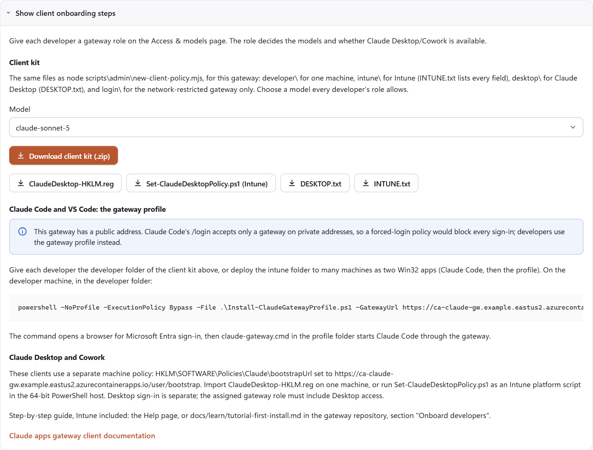

# Tutorial: Install the Claude apps gateway on Azure and onboard developers

The Claude apps gateway is a server that signs developers in with Microsoft Entra ID and forwards Claude Code's
requests to Claude models in Microsoft Foundry, so no model key reaches a developer machine
([Claude apps gateway](https://code.claude.com/docs/en/claude-apps-gateway)). This tutorial installs it into one Azure
resource group, with an admin console, then connects developer machines. Every command runs from the repository root in
one PowerShell 7 window, and each step shows the output that means it worked. Terms are defined in the
[glossary](glossary.md).

At the end of this tutorial:

- The gateway runs on Azure Container Apps and accepts connections from any network. Only people who sign in with
  Microsoft Entra ID and hold a gateway role can use it (docs/adr/0017-installer-option-to-allow-any-address.md:1).
- The gateway signs in to Entra with its own certificate, which a daily job renews; there is no client secret to renew
  by hand (docs/adr/0016-signin-certificate-in-key-vault-with-renewal-job.md:1).
- Spend, spend caps and chargeback data are kept in Azure Database for PostgreSQL, with 35 days of point-in-time
  restore (docs/adr/0012-test-topology-database-choice.md:50).
- The admin console opens only for the people named at install (docs/adr/0011-admin-ui-is-admin-only-with-sign-in.md:1).
- Developers use Claude Code through the gateway, installed by hand on one machine or by Intune on many.

This is the project's test topology: a public address, open to every network unless an address range is set, for
evaluation and pilots (ADR-0003, ADR-0017). A
gateway that has no public address and is reached over VPN or ExpressRoute, the design for production, is the subject
of [Tutorial: deploy in a network-restricted environment](tutorial-deploy-network-restricted.md).

In this tutorial, you:

- Check the tools and sign in to Azure
- Set the values every command uses
- Write the admin file from the example
- Preview and run the installer
- Open the admin console and give developers access
- Onboard developer machines, by hand and with Intune
- Check the gateway's sign-in credential

## Before you begin

The install needs three Microsoft roles. One person can hold all of them, or several people can each run their part
([Microsoft Entra built-in roles](https://learn.microsoft.com/en-us/entra/identity/role-based-access-control/permissions-reference)).

| Need | Why | Source |
|---|---|---|
| **Owner** on the Azure subscription | The install creates resources and gives the gateway's identity a role on the Foundry account | infra/azure-test/gateway-test.json:107-143 |
| An Entra account that may register applications, such as **Application Administrator** | The gateway signs developers in through its own app registration | https://learn.microsoft.com/en-us/entra/identity-platform/quickstart-register-app |
| **Privileged Role Administrator** or **Global Administrator**, for one step | The admin console reads users and roles through Microsoft Graph application permissions, which only these roles grant. When the installing account lacks the role, the install stops at its last stage and a person who holds it runs the commands of one step ([Run the install](#run-the-install)); in this project's installs the role was activated through Privileged Identity Management for the grant (docs/UNKNOWNS.md, U-75) | https://learn.microsoft.com/en-us/powershell/entra-powershell/grant-api-permissions-managed-identity |
| A subscription that can run Azure Container Registry Tasks, which build the two images; some trial and free-credit subscriptions cannot | `az acr build` builds the gateway and console images in Azure (infra/azure-test/deploy.mjs:281) | https://learn.microsoft.com/en-us/azure/container-registry/container-registry-tasks-overview |
| A Microsoft Foundry account with Claude models deployed, in the same subscription and Entra tenant as the install, that accepts traffic from public networks, and whose endpoint subdomain is its name, as Foundry creates it | The gateway calls Claude through it with its managed identity, and names it by the account name (config/gateway.azure-test.yaml:36); the identity gets a role on that account (infra/azure-test/gateway-test.json:107-143) | https://learn.microsoft.com/en-us/azure/foundry/foundry-models/how-to/use-foundry-models-claude |
| Optional: an existing resource group, for example the one that holds the Foundry account | `-UseExistingResourceGroup` installs into it; without the option the installer creates its own group | docs/adr/0018-existing-resource-group-preflight-and-database-first.md:1 |
| For Intune onboarding: the Intune **Application Manager** role, and Windows devices joined or registered to Entra ID and enrolled in Intune | Intune installs the developer apps | https://learn.microsoft.com/en-us/intune/intune-service/fundamentals/role-based-access-control |

Developers sign in with an e-mail address in the same domain as the account that runs the install, for example
`contoso.com`; the gateway admits that one domain (config/gateway.azure-test.yaml:20; infra/azure-test/deploy.mjs:218).
When the installing account's e-mail is in another domain, such as `contoso.onmicrosoft.com`, `-EmailDomain contoso.com`
on the install command sets the developers' domain instead.

Some tenants stop users from consenting to applications. Users of such a tenant see **Need admin approval** at their
first sign-in to the gateway or the console, and an Application Administrator grants consent once for each, as in
[Give developers access](#give-developers-access)
([grant tenant-wide admin consent](https://learn.microsoft.com/en-us/entra/identity/enterprise-apps/grant-admin-consent)).

The install costs money while it runs. The managed database's compute is $0.02 an hour in East US 2 and in Central US (Azure
Retail Prices API, 2026-10-25); Container Apps, Container Registry and Log Analytics are billed by use
([Container Apps pricing](https://azure.microsoft.com/pricing/details/container-apps/)). [Clean up
resources](#clean-up-resources) removes everything.

## Check the tools

Each command prints a version. This project's installs ran on Windows, which Intune packaging and the developer-machine steps also need
([PowerShell 7](https://learn.microsoft.com/en-us/powershell/scripting/install/installing-powershell),
[Node.js](https://nodejs.org/en/download), [Azure CLI](https://learn.microsoft.com/en-us/cli/azure/install-azure-cli),
[Git](https://git-scm.com/downloads)).

```powershell
pwsh --version
node --version
az --version
git --version
```

| Tool | Version needed | Example output |
|---|---|---|
| PowerShell | 7 or later | `PowerShell 7.5.2` |
| Node.js | 22 or later | `v22.11.0` |
| Azure CLI | 2.60 or later | `azure-cli 2.77.0` |
| Git | any | `git version 2.49.0.windows.1` |

A command reported as not recognized means the tool is missing; its link above installs it. Open a new PowerShell 7
window after installing a tool, so the new `PATH` applies.

## Get the files and sign in to Azure

The commands run from the root of the repository that holds this article, which contains the installer and the admin
file example. Its address for `git clone` is on its GitHub page under **Code**
([cloning a repository](https://docs.github.com/en/repositories/creating-and-managing-repositories/cloning-a-repository)).
The public copy, `naveenneog/claude-apps-gateway-foundry`, holds the revision last published (ADR-0006,
docs/adr/0006-publish-a-clean-public-copy.md:1). Sign-in uses the Azure CLI
([sign in with the Azure CLI](https://learn.microsoft.com/en-us/cli/azure/authenticate-azure-cli)):

```powershell
git clone <repository address>
Set-Location <repository folder>
az login
az account set --subscription "<subscription name or ID>"
az account show --query "{subscription:name,user:user.name}" -o table
az extension add --name containerapp --upgrade
```

`az account show` prints the subscription and the account every later command uses:

```output
Subscription          User
--------------------  -----------------------
Contoso Engineering   admin@contoso.com
```

A different subscription in that output means `az account set` named another one; the install goes into the
subscription shown here.

## Set the values every command uses

These variables hold the values the later commands read. They last as long as the PowerShell window; a new window
needs them set again.

```powershell
$rg = 'rg-claude-gw-eval'
$foundryRg = '<resource group of your Foundry account>'
$foundry = '<name of your Foundry account>'
$admins = az account show --query user.name -o tsv
$regions = 'eastus2,centralus,westus3'
"$rg $foundryRg $foundry $admins $regions"
```

| Variable | Value |
|---|---|
| `$rg` | The resource group for the gateway. The installer creates it; for a group that already exists, the install command also takes `-UseExistingResourceGroup` ([resource groups](https://learn.microsoft.com/en-us/azure/azure-resource-manager/management/manage-resource-groups-portal)) |
| `$foundryRg`, `$foundry` | The Foundry account's resource group and name, from its **Overview** page in the Azure portal |
| `$admins` | Who may open the admin console: the signed-in account. Several people are written as `'a@contoso.com,b@contoso.com'`. A guest or personal Microsoft account prints a name that is not a user principal name of the tenant; `$admins` is then set to a member account of the tenant |
| `$regions` | The regions to try for the managed database, in order. The installer skips a region that does not offer the database to the subscription and moves to the next when one refuses it (infra/azure-test/lib/preflight.mjs:59) |

### Choose who can reach the gateway

By default the gateway and the admin console accept connections from any network, so developers connect from the office,
from home and over a VPN alike. The gateway refuses a person who is not signed in with Microsoft Entra ID or holds no
gateway role; the console admits only the accounts in `` (infra/azure-test/Install-ClaudeGateway.ps1:191).

To accept connections from one public address block only, the install command takes `-TesterCidr <block>` for the
gateway and `-AllowedCidr <block>` for the console, each on its own. The block is `/24` or narrower, written as its
first address, for example `198.51.100.0/26`; the network team knows the company's block. A machine outside the block
gets HTTP 403 with the body `RBAC: access denied`
([IP restrictions](https://learn.microsoft.com/en-us/azure/container-apps/ip-restrictions)). The ranges in this article's
examples, `198.51.100.0/24` and `203.0.113.0/24`, are documentation ranges
([RFC 5737](https://www.rfc-editor.org/rfc/rfc5737)) that no machine connects from.

The install records the choice in `infra/azure-test/.state/<resource group>.json`, and a later run keeps it.
## Find your Claude deployments in Foundry

The admin file names each Claude model by its deployment name in Foundry
([az cognitiveservices account deployment](https://learn.microsoft.com/en-us/cli/azure/cognitiveservices/account/deployment)):

```powershell
az cognitiveservices account deployment list -g $foundryRg -n $foundry --query "[].{deployment:name,model:properties.model.name}" -o table
```

```output
Deployment       Model
---------------  ---------------
claude-sonnet-5  claude-sonnet-5
claude-opus-5    claude-opus-5
```

The left column is what the admin file needs. An empty table means the account has no deployment yet;
[Deploy and use Claude models in Microsoft Foundry](https://learn.microsoft.com/en-us/azure/foundry/foundry-models/how-to/use-foundry-models-claude)
creates one.

## Write the admin file

The admin file lists who may use the gateway, which models each group may use, and spend caps; the installer turns it
into the gateway's configuration (docs/adr/0004-operator-and-developer-tooling.md:1). The repository's example is valid
as shipped (tests/admin-config.test.mjs, T-118). Copy it, then open the copy:

```powershell
Copy-Item config/gateway-admin.example.json config/gateway-admin.azure-eval.json
notepad config/gateway-admin.azure-eval.json
```

In the copy, each `"deployment"` value under `models` is changed to a deployment name from the previous step. `id` is
the name developers and `--fast-model` use for the model, and changes with it when the deployment holds another model;
the same `id` is then changed in each `policies` entry that lists it. A model
with no deployment is removed from `models` and from each `policies` entry that lists it. The other values:

| Field | In the example | Meaning |
|---|---|---|
| `roles` | `Gateway.Standard`, `Gateway.Premium` | The two access levels a developer can be given (infra/azure-test/entra-app.json:1) |
| `policies` | Premium: both models and Claude Desktop; Standard: Sonnet only | What each access level may use ([gateway configuration](https://code.claude.com/docs/en/claude-apps-gateway-config#managed)) |
| `deployment.adminApi` | `true` | Turns on the spend-limits API the admin console uses (docs/adr/0008-admin-ui-for-the-gateway-spend-limits-api.md:1) |
| `deployment.database` | `"managed"` | Keeps spend and chargeback when the configuration changes ([choose the database](how-to-install-stage-by-stage.md#choose-the-database)) |
| `budgets` | 100 USD a month for the whole organization | A spend cap; the admin console changes it later ([spend limits](https://code.claude.com/docs/en/claude-apps-gateway-spend-limits)) |

The file is checked by rendering it:

```powershell
node scripts/admin/new-gateway-config.mjs --topology test --admin config/gateway-admin.azure-eval.json --out config/gateway.azure-eval.yaml
```

```output
wrote config/gateway.azure-eval.yaml: 2 models, 2 roles, 2 policies.
Deploy it with: node infra/azure-test/deploy.mjs --tester-cidr <range> --step app
```

The second line is for running stages one at a time; the installer in the next steps runs that stage itself.

A mistake is reported by field, for example `models[1].deployment: ...`, and nothing is written
(scripts/admin/new-gateway-config.mjs:31-85).

## Preview the install

`-Plan` runs the read-only checks of the `preflight` stage and prints every other command the installer would run; it
changes nothing (infra/azure-test/lib/preflight.mjs:59):

```powershell
pwsh -File infra/azure-test/Install-ClaudeGateway.ps1 -ResourceGroup $rg -AdminFile config/gateway-admin.azure-eval.json -FoundryResourceGroup $foundryRg -FoundryAccount $foundry -AppRegistrationName claude-apps-gateway-eval -SignInAdmins $admins -DatabaseLocation $regions -Plan
```

With a group that already exists, the command also takes `-UseExistingResourceGroup`. The checks cover each prerequisite in [Before you begin](#before-you-begin) that can be read: the tools, the
Azure and Entra roles, the Foundry account and its deployments, the resource providers, the sign-in e-mail claim and the
database regions. They print one line each; a `FAIL` line names what to change before the install:

```output
[deploy] preflight: PASS  tools: Node.js 22.11.0, Azure CLI 2.77.0 with the containerapp extension
[deploy] preflight: PASS  Azure role: the signed-in account may create the resource group and assign roles in the subscription
[deploy] preflight: PASS  resource group rg-claude-gw-eval: does not exist; the base stage creates it in eastus2
[deploy] preflight: PASS  Foundry account ai-contoso: holds claude-sonnet-5, claude-opus-5
[deploy] preflight: PASS  Foundry account ai-contoso: reachable from public networks at its own name
[deploy] preflight: PASS  Foundry account ai-contoso: the signed-in account may give the gateway's identity a role on it
[deploy] preflight: PASS  Entra: may register the gateway's app
[deploy] preflight: WARN  Entra: the signed-in account holds neither Privileged Role Administrator nor Global Administrator (active), so the admin-ui stage stops at the Microsoft Graph grant; ...
[deploy] preflight: PASS  resource providers: Microsoft.App, Microsoft.ContainerRegistry, Microsoft.OperationalInsights, Microsoft.ManagedIdentity registered
[deploy] preflight: PASS  sign-in: the gateway reads the email claim; the installing account has an e-mail address
[deploy] preflight: WARN  database region eastus2: Burstable Standard_B1ms is not offered; skipped
[deploy] preflight: PASS  database region centralus: PostgreSQL 16, Burstable Standard_B1ms offered
[deploy] preflight: passed; nothing was changed
```

The output ends with:

```output
== admin-ui ==
  pwsh -NoProfile -File <repository>\infra\azure-test\..\..\admin-ui\infra\Deploy-AdminUi.ps1 -ResourceGroup rg-claude-gw-eval -EnvironmentName cae-claude-gw -GatewayAppName ca-claude-gw -AcrName <acrName the base stage records> -AppRegistrationName claude-apps-gateway-eval -AdminFile config\gateway-admin.azure-eval.json -AllowedCidr 0.0.0.0/0 -Topology test -EnableSignIn -SignInAdmins admin@contoso.com -AllowAnyAddress
=== plan: 8 stage(s) would run ===
```

## Run the install

The same command without `-Plan`. The `base` stage creates the managed database first, in the first region of
`$regions` that accepts it, so a refused region shows in the first minutes (docs/UNKNOWNS.md, U-105 and U-135). The
`app` stage gives the gateway a self-signed sign-in certificate valid for 12 months; `-CredentialValidityMonths` sets 1
to 24 ([Check the gateway's sign-in credential](#check-the-gateways-sign-in-credential)):

```powershell
pwsh -File infra/azure-test/Install-ClaudeGateway.ps1 -ResourceGroup $rg -AdminFile config/gateway-admin.azure-eval.json -FoundryResourceGroup $foundryRg -FoundryAccount $foundry -AppRegistrationName claude-apps-gateway-eval -SignInAdmins $admins -DatabaseLocation $regions
```

The installer runs eight stages in order and prints `== <stage> ==` as each starts
(infra/azure-test/Install-ClaudeGateway.ps1:210). On 2026-10-21 the first six took about eight minutes
(docs/TEST-PLAN.md, T-91); creating the managed database adds several minutes. On 2026-11-03 an install into an existing
group, with the database falling back from East US to Central US, took about 25 minutes (docs/TEST-PLAN.md, T-161). A finished install ends with the two
addresses to keep, and the console identity's object ID, which the Microsoft Graph grant below needs:

```output
[deploy] registered sign-in certificate <thumbprint>; it ends <date>
...
[deploy] gateway: https://ca-claude-gw.<environment>.eastus2.azurecontainerapps.io
...
  admin-ui: https://ca-admin-ui.<environment>.eastus2.azurecontainerapps.io
  identity principal: <object ID of id-admin-ui>
...
=== done ===
=== install complete ===
```

The install writes `infra/azure-test/.state/<resource group>.json`, which git does not track (.gitignore:7). Changing
the address range, updating the release and clean-up read it, so they run in this repository folder on this machine, and
a copy of the file kept with the deployment's records, placed in the same folder of another clone together with the
admin file `config/gateway-admin.azure-eval.json`, which git does not track either, lets another machine
run them. The gateway is deployed to East
US 2 unless the install command has `-Location <region>` (infra/azure-test/deploy.mjs:57).

When a stage stops, the installer names it and the section of
[Install the Claude apps gateway, stage by stage](how-to-install-stage-by-stage.md) that does it by hand
(infra/azure-test/Install-ClaudeGateway.ps1:218). The stops seen in this project's installs:

| Stop | Cause | What fixes it |
|---|---|---|
| `admin-ui` stops with `Authorization_RequestDenied` | The account lacks Privileged Role Administrator for the Microsoft Graph grant (docs/UNKNOWNS.md, U-75) | 1. A Privileged Role Administrator, with the role active (in Privileged Identity Management when the tenant uses it), opens Azure Cloud Shell in **PowerShell** and runs [the Cloud Shell commands of the admin-ui stage](how-to-install-stage-by-stage.md#admin-ui), which give the console's identity its four permissions. When Cloud Shell is not available to that person, the same commands run in PowerShell 7 on any machine with the Azure CLI after `az login --allow-no-subscriptions`. 2. The installing account runs the install command again without `-TesterCidr` and with `-Steps admin-ui`: it reports `already granted` for the four, makes the console an owner of the gateway's app registration, which the **Roles** page needs, and deploys the console again (`admin-ui/infra/Deploy-AdminUi.ps1`, lines 240-265). When the **Developers** page still reports a missing permission, `az containerapp revision restart -n ca-admin-ui -g $rg --revision <revision>`, with the name from `az containerapp revision list -n ca-admin-ui -g $rg -o table`, starts it with a new Microsoft Graph token (admin-ui/server/managed-identity.mjs:12-16) |
| `preflight` prints `FAIL  database: no region in ... offers Burstable Standard_B1ms` | None of the regions in `$regions` offers the database to this subscription. In this project's Contoso subscription East US answered `restricted` and East US 2 refused at creation time (docs/UNKNOWNS.md, U-105 and U-135) | `$regions` set to more regions, for example `'centralus,westus3,northcentralus'`, then the same install command. `base` also moves to the next region on its own when a region passes the check and still refuses the server |
| `preflight` prints `FAIL  resource group ...: the resource group exists and was not created by this tool` | `$rg` names a group that already exists | The same install command with `-UseExistingResourceGroup`. The installer adds its resources next to what is there and never deletes the group (docs/adr/0018-existing-resource-group-preflight-and-database-first.md:1) |
| `preflight` prints `FAIL  Foundry account ...: no deployment named ...` | The admin file names a deployment the Foundry account does not hold | `models[].deployment` in the admin file set to a name from [Find your Claude deployments in Foundry](#find-your-claude-deployments-in-foundry) |
| `app` stops with `deployments/claude-gw-app returned 503` | Azure Resource Manager answered the status check with a temporary error; the deployment itself was submitted and keeps running. The installer now retries such answers (docs/UNKNOWNS.md, U-129), so a copy from before 2026-11-03 shows it | `az deployment group show -g $rg -n claude-gw-app --query properties.provisioningState -o tsv` until it prints `Succeeded` or `Failed`, then the same install command with `-Steps app,budgets,admin-ui`. With `Failed`, `az deployment operation group list -g $rg -n claude-gw-app --query "[?properties.provisioningState=='Failed'].properties.statusMessage" -o json` names the cause |
| `the gateway is ready, but this machine gets 403 for ...` | The install was limited with `-TesterCidr`, and this machine's public address is outside that block (docs/UNKNOWNS.md, U-33) | This machine connects from inside the block (on the company network or VPN), then the same install command with `-Steps app,budgets,admin-ui`. Without `-TesterCidr` the gateway accepts every address and this stop does not occur |
| `certificate sign-in did not work (...); falling back to a client secret` | The tenant refused a certificate on the app registration, for example by an app management policy (docs/UNKNOWNS.md, U-133). The install continues with a client secret of `-ClientSecretDays` days, 365 by default | Nothing for the install. To sign in with a certificate later, the tenant's policy is changed and the install command runs with `-SignInCredential certificate -Steps app` |
| `Entra refused a client secret of 365 days` | The tenant's app management policy caps client secret lifetimes | The same install command with `-ClientSecretDays` at or under the tenant's limit, for example `-ClientSecretDays 30`; the renewal job renews it 30 days before it ends |
| `the app registration holds certificate(s) ... not made by the installer` | Someone added a certificate to the gateway's app registration by hand. Microsoft Graph replaces all of an application's certificates at once, so the installer stops rather than remove it (infra/azure-test/lib/signin.mjs) | The certificate removed under **App registrations** > the gateway's registration > **Certificates & secrets**, then the same install command with `-Steps app` |
| `preflight` prints `FAIL  sign-in: the installing account ... has no e-mail address` | The installing account has no e-mail address in Entra ID, as in many trial tenants, so its ID token has no `email` claim and the gateway would refuse its sign-in with `id_token missing email claim` (seen on 2026-11-04) | `"emailClaim": "preferred_username"` added under `deployment` in the admin file, so the gateway reads the sign-in name, then the same install command. The `entra` stage then admits the sign-in name's domain; when developers' names are in another domain, `-EmailDomain` sets it, for example `-EmailDomain contoso.com` (docs/UNKNOWNS.md, U-81) |

Every stage can run again: a stage that already ran finds its resources and changes only what differs
(docs/adr/0009-a-staged-installer-over-the-existing-deploy-scripts.md:1). After the admin console has saved the
gateway's configuration, the `app` stage keeps the console's configuration and prints `the admin console saved this
gateway's configuration; the app step keeps it and does not deploy <file>` (infra/azure-test/deploy.mjs:332-334); models,
roles and policies are then changed in the console. A later run names its stages with `-Steps`, such as `-Steps app` or
`-Steps admin-ui`, and keeps the recorded address choice unless `-TesterCidr` or `-AllowedCidr` changes it: the `budgets` stage sets the spend caps from
the admin file again, replacing caps changed in the console
([install stage by stage](how-to-install-stage-by-stage.md#budgets)), and the admin file on disk does not hold
roles or models added in the console.

## Open the admin console

The console is at the `admin-ui:` address the install printed. Both addresses are also on each Container App's
**Overview** page in the Azure portal, `ca-claude-gw` and `ca-admin-ui` in `$rg`, as **Application Url**. It asks for a Microsoft sign-in, then opens the
**Dashboard**; an account named in `$admins` sees **Admin** next to its name (ADR-0011,
docs/adr/0011-admin-ui-is-admin-only-with-sign-in.md:1). Its pages are described in
[Use the admin console](how-to-use-admin-console.md).

| What appears | Meaning |
|---|---|
| `RBAC: access denied` | The console was limited with `-AllowedCidr`, and this machine's address is outside that block ([troubleshoot](troubleshoot.md)) |
| `AADSTS50105` from Microsoft sign-in | The account has no assignment on the console's sign-in application, `claude-apps-gateway-eval-admin-ui-signin`; the install command without `-TesterCidr`, with that account added to `-SignInAdmins` and with `-Steps admin-ui`, assigns it; before the Microsoft Graph grant is in place the run stops at the grant, after the assignment ([troubleshoot](troubleshoot.md#gateway-and-admin-console)) |
| **AdminUi.Admin is required** | The account is assigned to the sign-in application without the `AdminUi.Admin` role; the same command assigns the role |
| **Need admin approval** | The tenant stops user consent; an Application Administrator grants it as in [Give developers access](#give-developers-access) |

The installing account already holds `Gateway.Standard` (infra/azure-test/deploy.mjs:255), so the gateway can be
checked end to end before any developer is onboarded: [Onboard developers](#onboard-developers), the `new-client-policy.mjs` command and
[One machine](#one-machine), on this machine when it runs Windows, then [Check that it works](#check-that-it-works).

## Give developers access

The account that ran the install already holds `Gateway.Standard` (infra/azure-test/deploy.mjs:255). On the console's
**Developers** page, a user principal name and a role, `Gateway.Standard` or `Gateway.Premium`, then
**Grant role** gives a developer access (docs/learn/how-to-use-admin-console.md:59). The role decides the models and
whether Claude Desktop is available, as the admin file's `policies` set them. For a group of developers, the
**Enterprise applications** page in the Microsoft Entra admin center assigns a role to an Entra group, which needs
Microsoft Entra ID P1 or P2; assigning users one at a time there needs neither
([assign users and groups](https://learn.microsoft.com/en-us/entra/identity/enterprise-apps/assign-user-or-group-access-portal)).
The steps for a group, and for putting developers into departments for chargeback, are in
[Group developers into departments and teams](how-to-organize-departments.md).
The gateway's enterprise application has the name given as `-AppRegistrationName`, `claude-apps-gateway-eval`. Before
the Microsoft Graph grant is in place the **Developers** page cannot assign roles; this command does the same from the
installing machine (scripts/admin/set-developer.mjs:1-12):

```powershell
node scripts/admin/set-developer.mjs --upn dev@contoso.com --role Gateway.Standard --admin config/gateway-admin.azure-eval.json --resource-group $rg
```

In a tenant that stops user consent, sign-in shows **Need admin approval** until an Application Administrator grants
consent once for each of the two applications: Microsoft Entra admin center > **Enterprise apps** > **All
applications** > `claude-apps-gateway-eval`, then `claude-apps-gateway-eval-admin-ui-signin` > **Permissions** >
**Grant admin consent**. The gateway's application asks only for sign-in permissions (infra/azure-test/entra-app.json:37-42)
([grant tenant-wide admin consent](https://learn.microsoft.com/en-us/entra/identity/enterprise-apps/grant-admin-consent)).
The console's sign-in application declares no permissions, so its prompt, if any, asks only for sign-in. This
project's tenant allowed user consent, so this step was not needed in its installs, and whether **Grant admin consent**
clears the prompt for the console's application is untested (docs/UNKNOWNS.md, U-108).

## Onboard developers

This gateway has a public address. Claude Code's built-in gateway sign-in, `/login`, accepts only a gateway whose name
resolves to private addresses, so a device policy that forces it would stop every sign-in
([prerequisites](https://code.claude.com/docs/en/claude-apps-gateway#prerequisites)). Developers use the gateway
profile instead: a separate Claude Code profile that signs in to the gateway once and sends Claude Code's requests to
it, without administrator rights and without changing the developer's own Claude Code settings
(docs/adr/0004-operator-and-developer-tooling.md:15-17).

One command writes everything the developer machines need, from the gateway address the install printed. `--model`
and `--fast-model` take a model `id` from the admin file that every developer's role allows; in the example that is
`claude-sonnet-5`, the one model of `Gateway.Standard` (config/gateway-admin.example.json:10):

```powershell
node scripts/admin/new-client-policy.mjs --gateway-url https://ca-claude-gw.<environment>.eastus2.azurecontainerapps.io --fast-model claude-sonnet-5 --model claude-sonnet-5 --out .\client-policy
```

```output
wrote C:\...\client-policy: login\ (managed-settings.json, ClaudeCode-HKLM.reg, ClaudeCode.mobileconfig), developer\, intune\ (INTUNE.txt) and desktop\ (DESKTOP.txt).
```

The lines after it explain why `login\` does not apply here. A second run into the same folder needs `--force`
(scripts/admin/new-client-policy.mjs:14-16).

| Folder | For |
|---|---|
| `client-policy\developer` | One machine, set up by the developer |
| `client-policy\intune` | Many machines, set up by Intune; `INTUNE.txt` holds every Intune field value |
| `client-policy\desktop` | Claude Desktop: `ClaudeDesktop-HKLM.reg` for one machine, `Set-ClaudeDesktopPolicy.ps1` for Intune, `DESKTOP.txt` with the steps |
| `client-policy\login` | The network-restricted deployment only; it does not work with this gateway |

The folders are described in scripts/admin/new-client-policy.mjs:1-16. `New-IntunePackage.ps1` is copied to the top of
the folder.

The admin console downloads the same folder, without the repository or Node.js: **Settings** > **Client onboarding**
> a model > **Download client kit (.zip)**, or a single file from the buttons below it
([Use the admin console](how-to-use-admin-console.md)). The zip, extracted, is the `client-policy` folder these
steps use.



### One machine

The administrator gives the developer the `client-policy\developer` folder, for example as a zip file on a file share;
it holds the scripts and `START-HERE.txt`, the same steps in plain text. The developer needs Claude Code, and, when the install set `-TesterCidr`, a network inside that block: `winget install Anthropic.ClaudeCode` installs it, after which a new Windows PowerShell window finds
the `claude` command ([set up Claude Code](https://code.claude.com/docs/en/setup)). In Windows PowerShell, in the
folder:

```powershell
Set-Location <folder that holds Install-ClaudeGatewayProfile.ps1>
powershell -NoProfile -ExecutionPolicy Bypass -File .\Install-ClaudeGatewayProfile.ps1 -GatewayUrl https://ca-claude-gw.<environment>.eastus2.azurecontainerapps.io -FastModel claude-sonnet-5 -Model claude-sonnet-5
```

The browser opens the gateway's page with a code; the developer checks that it matches the code PowerShell shows,
confirms it and signs in with the work account. Back in PowerShell, the script names the account and asks to keep the
session; **Y** keeps it (scripts/developer/Connect-ClaudeGateway.ps1:63-79):

```output
Signed in to https://ca-claude-gw.<environment>.eastus2.azurecontainerapps.io as dev@contoso.com. Get-ClaudeGatewayToken.ps1 now serves tokens for this gateway.
```

`-Model` sets the model Claude Code asks for, and `-FastModel` the one for background tasks; both are models the
developer's role allows. Without `-Model`, Claude Code asks for its own default model, which a role that does not list
it refuses with HTTP 400 (docs/TEST-PLAN.md, T-88; [model configuration](https://code.claude.com/docs/en/model-config)).
A developer whose role allows more models chooses with `/model` in Claude Code.

From then on the launcher starts Claude Code through the gateway:

```powershell
& "$env:USERPROFILE\.claude-apps-gateway\claude-gateway.cmd"
```

Each message the profile can show, and its fix, is in
[Quickstart: connect Claude Code on Windows](quickstart-developer.md).

### Many machines with Intune

Intune installs two Win32 apps on each machine: **Claude Code** itself, for every user of the device, and the
**gateway profile**, for the signed-in developer, without signing in, because Intune installs without showing anything
to the user ([add a Win32 app](https://learn.microsoft.com/en-us/intune/app-management/deployment/add-win32)). The
Claude Code app downloads release 2.1.284 from Anthropic and installs it only when its SHA-256 matches the release's
(scripts/admin/intune-package.mjs:17-20). The devices are Windows 10 or 11 Enterprise, Pro or Education, joined or
registered to Entra ID and enrolled in Intune
([Win32 app prerequisites](https://learn.microsoft.com/en-us/intune/app-management/deployment/create-win32-package#prerequisites)).

1. The [Microsoft Win32 Content Prep Tool](https://go.microsoft.com/fwlink/?linkid=2065730) link opens its GitHub
   repository; **Code** > **Download ZIP**, extracted to `C:\tools\prep`, gives
   `C:\tools\prep\Microsoft-Win32-Content-Prep-Tool-master\IntuneWinAppUtil.exe`; `-ToolPath` names that file.
1. Package the two app folders. The script runs the tool once per app and prints the two files it wrote
   (scripts/admin/New-IntunePackage.ps1:40-47):

   ```powershell
   pwsh -File scripts/admin/New-IntunePackage.ps1 -PolicyFolder .\client-policy -ToolPath C:\tools\prep\Microsoft-Win32-Content-Prep-Tool-master\IntuneWinAppUtil.exe -OutputFolder .\intunewin
   ```

   ```output
   C:\...\intunewin\Install-ClaudeCode.intunewin
   C:\...\intunewin\Install-Profile.intunewin
   ```
1. In the [Microsoft Intune admin center](https://intune.microsoft.com), **Apps** > **All Apps** > **Create** >
   **Windows app (Win32)** > **Select**, then **Select app package file** > `Install-ClaudeCode.intunewin` > **OK**.
   Then the values for **App 1** in the table below, page by page, and **Create**.
1. Create a second app the same way from `Install-Profile.intunewin`, with the values for **App 2**.
1. Intune assigns apps to Entra groups of users or devices. A security group of developers, such as `Claude Code
   pilot`, is created in the Microsoft Entra admin center under **Groups** > **New group**, which needs the Groups Administrator
   role or a tenant that lets users create security groups
   ([create a group](https://learn.microsoft.com/en-us/entra/fundamentals/how-to-manage-groups)). On each app's
   **Assignments** page, in the creation wizard or later under the app's **Properties** > **Assignments** > **Edit**,
   **Required** > **Add group** > that group. After the pilot machines report **Installed** under
   the app's **Device install status**, a group of every developer who holds a gateway role is added the same way. The
   gateway role itself is given as in [Give developers access](#give-developers-access); without Entra ID P1 or P2 it is
   given per user, so the Intune group and the role holders are two lists, kept with the same people.

| Intune page and field | App 1: Claude Code | App 2: gateway profile |
|---|---|---|
| **App information** > **Name** and **Publisher** | `Claude Code`, `Anthropic` | `Claude Code gateway profile`, your organization |
| **Program** > **Install command** | `%SystemRoot%\Sysnative\WindowsPowerShell\v1.0\powershell.exe -NoProfile -ExecutionPolicy Bypass -File .\Install-ClaudeCode.ps1` | `%SystemRoot%\Sysnative\WindowsPowerShell\v1.0\powershell.exe -NoProfile -ExecutionPolicy Bypass -File .\Install-Profile.ps1` |
| **Program** > **Uninstall command** | The same, with `.\Uninstall-ClaudeCode.ps1` | The same, with `.\Uninstall-Profile.ps1` |
| **Program** > **Install behavior** | **System** | **User** |
| **Requirements** > **Operating system architecture** (**Allow on x64** in newer pages) | x64; the package holds the `win32-x64` release, so Arm devices get nothing | x64 |
| **Requirements** > **Minimum operating system** | Windows 10 1809, the oldest Claude Code supports ([requirements](https://code.claude.com/docs/en/setup)) | Windows 10 1809 |
| **Detection rules** | **Manually configure detection rules** > **Add** > **File**: path `%ProgramFiles%\Anthropic\ClaudeCode`, file `claude-code-2.1.284.installed`, the release marker the install writes, **File or folder exists**, **Associated with a 32-bit app on 64-bit clients**: **No** | **Use a custom detection script** > `Detect-Profile.ps1` from `client-policy\intune\2-gateway-profile`; **Run script as 32-bit process on 64-bit clients**: **No**; **Enforce script signature check**: **No** |
| **Dependencies** | None | **Add** > App 1, **Automatically install**: **Yes** |

App 2 runs with `-ReplaceGateway`, so on a machine whose `.claude-apps-gateway` profile pointed at another gateway it
then points at this one.

The `Sysnative` path runs 64-bit Windows PowerShell, as Intune's documentation gives for an install command; the
detection script reports the app as installed by writing to its output and exiting 0
([program and detection settings](https://learn.microsoft.com/en-us/intune/app-management/deployment/add-win32#step-2-program)).
The same values are in `client-policy\intune\INTUNE.txt` with the gateway address filled in. During the install, the
device, as the SYSTEM account, reaches `https://downloads.claude.ai`, directly or through a proxy that asks for no user
sign-in, where Anthropic publishes Claude Code
([network access](https://code.claude.com/docs/en/network-config#network-access-requirements)).

Intune shows the developer nothing, so the administrator sends each developer a message once the app reports
**Installed** for them, for example:

```text
Claude Code is installed on your PC and connects through the company gateway. You have been given access.
On the company network, open Windows PowerShell and run once:
  & "$env:USERPROFILE\.claude-apps-gateway\sign-in.cmd"
Check that the code in the browser matches the one in PowerShell, sign in with your work account, and answer Y.
From then on, start Claude Code with:
  & "$env:USERPROFILE\.claude-apps-gateway\claude-gateway.cmd"
```

The same steps are in `client-policy\intune\INTUNE.txt` (scripts/admin/intune-package.mjs:224-227). The sign-in is the
one in [One machine](#one-machine). The two commands:

```powershell
& "$env:USERPROFILE\.claude-apps-gateway\sign-in.cmd"
& "$env:USERPROFILE\.claude-apps-gateway\claude-gateway.cmd"
```

On 2026-10-25 the two `.intunewin` files were built with `New-IntunePackage.ps1` and the Content Prep Tool, the Claude Code app installed release
2.1.284 with a matching checksum, and the profile app, run as a user against this project's gateway, wrote the profile
and a `sign-in.cmd` that started a gateway sign-in (docs/TEST-PLAN.md, T-120). The apps have not yet been assigned in
an Intune tenant (docs/UNKNOWNS.md, U-107). The Claude Code app installs one release under Program Files, 2.1.284 unless another is chosen
(scripts/admin/intune-package.mjs:17-20), which the developer starts only through the launcher and which does not update
itself, because the profile app sets `DISABLE_UPDATES` ([environment variables](https://code.claude.com/docs/en/env-vars));
[Package a newer Claude Code release](#package-a-newer-claude-code-release) replaces it. A change of `--model` is
checked against the models each role allows before the profile package is rebuilt. `--fast-model` and `--model` on `new-client-policy.mjs` name models the
admin file keeps.

### Claude Desktop

Claude Desktop reads the gateway address from the device policy `bootstrapUrl` under
`HKLM\SOFTWARE\Policies\Claude`, set to `<gateway address>/user/bootstrap`, and signs in on its own
([connect Claude Desktop](https://code.claude.com/docs/en/claude-apps-gateway#connect-claude-desktop)). In Intune a
**Platform script** in system context writes that value
([Connect clients](how-to-connect-clients.md#deliver-the-policy-with-intune-or-group-policy)). The client-policy
folder's `desktop` folder holds that script, `Set-ClaudeDesktopPolicy.ps1`, the same value as `ClaudeDesktop-HKLM.reg` for
one machine, and `DESKTOP.txt` with each Intune setting, including **Run script in 64-bit PowerShell host**: **Yes**;
the script stops with exit code 1 in a 32-bit host, which would write the value where Desktop does not read it
(scripts/admin/desktop-policy.mjs:15-35). Desktop signs in to this public
gateway with its own device code, separate from the Claude Code profile, for a developer whose role's policy turns
Desktop on: `Gateway.Premium` in the example admin file (docs/UNKNOWNS.md, U-106). A role's Chat, Cowork and Code
switches are set with `desktopSettings` on its policy in the admin file
([configure models, roles and developer access](how-to-admin-configure.md#claude-desktop-chat-cowork-and-code)); Desktop
applies the gateway's values over local settings.

### When Intune reports Failed or Not detected

The Intune Management Extension checks for new and changed Win32 apps every 8 hours; **Devices** > the device > **Sync**
in the Intune admin center, or **Sync** in the Company Portal app, starts a check sooner
([Intune Management Extension](https://learn.microsoft.com/en-us/intune/device-management/tools/management-extension-windows);
[sync a device](https://learn.microsoft.com/en-us/intune/device-management/actions/sync)). Each app's **Device install
status** page names the device; a failed install script reports exit code 1 for every
cause, so the cause is in the scripts' own logs on the device, which the scripts write because Intune keeps neither
their output nor their errors (scripts/admin/intune-package.mjs:32-33):

| App | Log on the device |
|---|---|
| App 1, Claude Code | `%ProgramFiles%\Anthropic\ClaudeCode\install-claude-code.log` |
| App 2, gateway profile | `%LOCALAPPDATA%\ClaudeAppsGateway\install-profile.log` of the developer |

Intune's own record of each Win32 app install is `AppWorkload.log` in
`%ProgramData%\Microsoft\IntuneManagementExtension\Logs`
([Intune Management Extension](https://learn.microsoft.com/en-us/intune/device-management/tools/management-extension-windows)).

| Log line | Cause | What fixes it |
|---|---|---|
| `failed:` with a download or connection error | The device, as SYSTEM, cannot reach `downloads.claude.ai` | The network or proxy lets the device reach it without a user sign-in |
| `failed: The download has checksum ...` | The package's checksum is not the release's `win32-x64` checksum, or the network altered the download | `--claude-checksum` is the `win32-x64` value of the same `--claude-version`, and the network passes the download unchanged; nothing was installed |
| `failed: Claude Code is running (...)` | A newer release was installing while Claude Code was open | Intune retries the install; it succeeds once Claude Code is closed |
| `failed: Install-ClaudeGatewayProfile: ...` | The profile script refused; the rest of the line is its message | The message's row in [Troubleshoot the developer profile](troubleshoot.md#installer-and-launcher-messages) |
| `failed: Claude Code was not found` | App 2 ran before App 1 | App 2's dependency on App 1, with **Automatically install**: **Yes** |
| App 2 **Not detected**, with `installed the profile` in its log | The detection script ran for another user | **Install behavior** of App 2 is **User** |

To run a script by hand on a test device, the app's folder from `client-policy\intune` is copied to the device, then
run from it in Windows PowerShell: App 1 in a window opened with **Run as administrator**, because it writes to
Program Files, and App 2 as the developer, for example
`powershell -NoProfile -ExecutionPolicy Bypass -File .\Install-ClaudeCode.ps1`.

### Package a newer Claude Code release

Anthropic publishes each release's checksums in its manifest. This command prints the Windows checksum of a release:

```powershell
$version = '<release, for example 2.1.290>'
(Invoke-RestMethod "https://downloads.claude.ai/claude-code-releases/$version/manifest.json").platforms.'win32-x64'.checksum
```

`new-client-policy.mjs` writes the Intune folder for that release with `--claude-version` and `--claude-checksum`
(scripts/admin/new-client-policy.mjs:15), with the same gateway address and models as before and `--force` to write into
the existing folder; without `--model` it warns, because the profile app would then pin no model:

```powershell
node scripts/admin/new-client-policy.mjs --gateway-url https://ca-claude-gw.<environment>.eastus2.azurecontainerapps.io --fast-model claude-sonnet-5 --model claude-sonnet-5 --claude-version $version --claude-checksum <checksum> --out .\client-policy --force
pwsh -File scripts/admin/New-IntunePackage.ps1 -PolicyFolder .\client-policy -ToolPath C:\tools\prep\Microsoft-Win32-Content-Prep-Tool-master\IntuneWinAppUtil.exe -OutputFolder .\intunewin
```

Then, in the Intune admin center,
App 1 > **Properties**: **App information** > **Edit** > **Select file to update** > the new `Install-ClaudeCode.intunewin`;
**Detection rules** > **Edit** > the file `claude-code-<release>.installed` > **Review + save**. Devices with the older
release no longer match the rule, so Intune installs the new one
([edit a Win32 app](https://learn.microsoft.com/en-us/intune/app-management/deployment/add-win32)).

## Check that it works

A developer machine sends one request through the gateway:

```powershell
& "$env:USERPROFILE\.claude-apps-gateway\claude-gateway.cmd" -p "Reply with exactly the word: ok"
```

```output
ok
```

The console's **Dashboard** then shows the request's spend, the sum of the gateway's per-user totals
(admin-ui/web/app.js:33), and **Chargeback** lists it by department ([Use the admin console](how-to-use-admin-console.md)). On the Contoso deployment, `claude -p` calls through the gateway
answered in 3.7 to 4.0 seconds (docs/TEST-PLAN.md, T-116).

## Run the installer again later

A later run, such as limiting the address range or updating the gateway's release, happens in a new PowerShell 7 window in the
repository folder that holds the state file, so it signs in and sets the values again first:

```powershell
az login
az account set --subscription "<subscription name or ID>"
$rg = 'rg-claude-gw-eval'
$foundryRg = '<resource group of your Foundry account>'
$foundry = '<name of your Foundry account>'
$admins = az account show --query user.name -o tsv
```

The run needs the account that installed, which owns the gateway's app registration, or an Application Administrator,
because the `app` stage adds and removes the registration's certificates and client secrets
([Application Administrator](https://learn.microsoft.com/en-us/entra/identity/role-based-access-control/permissions-reference#application-administrator)).

### Limit or change the address range

The install command with `-TesterCidr` limits the gateway, and with `-AllowedCidr` the console, to one block; a later run
with another block replaces it, and `-GatewayAllowAnyAddress` or `-ConsoleAllowAnyAddress` opens the app to every
address again (docs/adr/0017-installer-option-to-allow-any-address.md:1):

```powershell
pwsh -File infra/azure-test/Install-ClaudeGateway.ps1 -ResourceGroup $rg -AdminFile config/gateway-admin.azure-eval.json -TesterCidr 198.51.100.0/26 -AllowedCidr 198.51.100.0/26 -FoundryResourceGroup $foundryRg -FoundryAccount $foundry -AppRegistrationName claude-apps-gateway-eval -SignInAdmins $admins -Steps app,admin-ui
```

`198.51.100.0/26` is a documentation range; the command takes the company block. The `app` stage then checks the
gateway from this machine, so it runs from inside the block. Before the Microsoft Graph grant is in place, the
`admin-ui` stage stops at the grant after the console's range is set, as in the install; the range change has applied
by then.

## Check the gateway's sign-in credential

The gateway signs developers in through its app registration, and proves to Microsoft Entra ID that it is that
application with a self-signed certificate the `app` stage made (infra/azure-test/lib/credentials.mjs:67). The
certificate is valid for `-CredentialValidityMonths`, 12 months by default. Nobody renews it by hand:

- The console's job `job-signin-renewer` runs every day at 03:17 UTC and replaces the certificate 30 days before it
  ends. It registers the new certificate next to the old one, starts a gateway revision that uses the new one, and
  removes the old one once that revision is ready, so signed-in developers stay signed in
  (admin-ui/server/signin-renewer.mjs:23;
  [rotate the client certificate](https://code.claude.com/docs/en/claude-apps-gateway-config#rotate-the-client-certificate)).
- **Settings** > **Gateway sign-in credential** in the console shows the type, the certificate's thumbprint and its end
  date. **Renew now** replaces it at once, with a validity chosen from 1 to 24 months.
- A run of the `app` stage also replaces a certificate within 30 days of its end; `-RotateClientSecret` replaces it
  whatever its end date.

The certificate's thumbprint and end date are also under **App registrations** > `claude-apps-gateway-eval` >
**Certificates & secrets** in the Microsoft Entra admin center, and the gateway's log has a line
`oidc: client authentication private_key_jwt; certificate CN=claude-gateway <resource group>, SHA-1 thumbprint <thumbprint>`.

When the tenant refuses a certificate, the install uses a client secret of `-ClientSecretDays` days, 365 by default, and
the same job renews it 30 days before it ends (docs/adr/0016-signin-certificate-in-key-vault-with-renewal-job.md:1). The
job runs with the console's identity, so it works once the Microsoft Graph grant of the `admin-ui` stage is in place.

## Update the gateway's Claude Code release

The gateway image pins one Claude Code release, `CLAUDE_VERSION` and `CLAUDE_SHA256` in
infra/azure-test/image/Dockerfile:8-9, separately from the release the Intune package installs on developer machines.
The Dockerfile is a tracked file; the build reads the edited file without a commit, and a later `git pull` reports the
local change.
A newer release is set there, with its Linux checksum from the manifest,
`(Invoke-RestMethod "https://downloads.claude.ai/claude-code-releases/$version/manifest.json").platforms.'linux-x64'.checksum`, and the
install command with `-Steps image,app` builds and deploys it
([Claude apps gateway](https://code.claude.com/docs/en/claude-apps-gateway)), with the values from
[Run the installer again later](#run-the-installer-again-later):

```powershell
pwsh -File infra/azure-test/Install-ClaudeGateway.ps1 -ResourceGroup $rg -AdminFile config/gateway-admin.azure-eval.json -FoundryResourceGroup $foundryRg -FoundryAccount $foundry -AppRegistrationName claude-apps-gateway-eval -Steps image,app
```

 The gateway's live output is on the Container App
`ca-claude-gw` > **Monitoring** > **Log stream** in the Azure portal, and its history in the resource group's Log
Analytics workspace, table `ContainerAppConsoleLogs_CL` (docs/UNKNOWNS.md, U-98); this query lists the latest
lines ([Container Apps logs](https://learn.microsoft.com/en-us/azure/container-apps/log-monitoring)):

```kusto
ContainerAppConsoleLogs_CL
| where ContainerAppName_s == 'ca-claude-gw'
| project TimeGenerated, Log_s
| order by TimeGenerated desc
| take 50
```

The deployment sets up no alerts; an alert on these logs or on a failed `job-signin-renewer` run is created separately in Azure
Monitor ([log search alerts](https://learn.microsoft.com/en-us/azure/azure-monitor/alerts/alerts-create-log-alert-rule)).
The console's **Dashboard** shows spend, and [troubleshoot](troubleshoot.md#gateway-and-admin-console) lists the
gateway's messages.

## Clean up resources

With Intune, each app's **Required** assignment is first changed to **Uninstall**, so devices remove them while the
gateway still answers the profile's sign-out, and the apps are deleted under **Apps** > **All Apps** once the devices
report it, App 2 before App 1, which it depends on;
then the developer group is deleted under **Groups** in the Microsoft Entra admin center.

The teardown script removes the gateway's role on the Foundry account, its app registration and the resource group. In a
group that the install did not create (`-UseExistingResourceGroup`), it removes only the resources tagged with the
install's `runId` and keeps the group and everything else in it;
`--dry-run` lists them first (infra/azure-test/teardown.mjs:1-5). It reads the record the install wrote in
`infra/azure-test/.state/`, so it runs on the machine and in the folder that ran the install:

```powershell
node infra/azure-test/teardown.mjs --resource-group $rg --dry-run
node infra/azure-test/teardown.mjs --resource-group $rg
```

The admin console's sign-in app registration, `claude-apps-gateway-eval-admin-ui-signin`, is removed in the Microsoft
Entra admin center under **App registrations**. The local `client-policy`, `intunewin` and `infra\azure-test\.state` folders and any copy of the state
file are deleted after the teardown. On a developer machine, the profile is removed as
[the quickstart's clean-up](quickstart-developer.md#clean-up-resources) describes.

## Next steps

- [Use the admin console](how-to-use-admin-console.md)
- [Manage users, groups and budgets](how-to-manage-users-and-groups.md)
- [Install the Claude apps gateway, stage by stage](how-to-install-stage-by-stage.md)
- [Troubleshoot the developer profile](troubleshoot.md)
